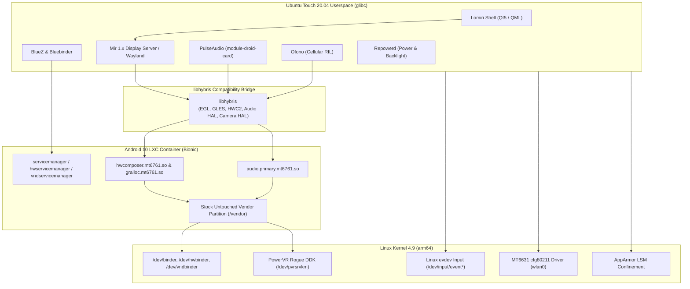

# Lenovo Tab M8 HD (TB-8505X) — Ubuntu Touch Device Port

[](https://ubports.com)
[](https://www.lenovo.com)
[](#hardware-specifications)
[](#hardware-specifications)
[](LICENSE)

An open-source, device-specific port of **Ubuntu Touch (Lomiri)** for the **Lenovo Tab M8 HD (2nd Gen LTE / TB-8505X)**, codename **`akita_row_call`**.

Unlike generic GSIs, this project maintains the exact device tree, kernel configurations, hardware adaptation overlay, build scripts, and disaster recovery infrastructure required for a stable native Ubuntu Touch ROM.

---

## Hardware Specifications

| Property | Value | Notes |
|---|---|---|
| **Manufacturer & Model** | Lenovo TB-8505X | Lenovo Tab M8 HD (2nd Gen, LTE) |
| **Board / Product Codename**| `akita_row_call` | Rest of World (ROW), Cellular Voice/Data (`call`) |
| **SoC** | MediaTek Helio A22 (`mt6761`) | Quad-core ARM Cortex-A53 up to 2.0 GHz |
| **Boot Hardware Revision** | `mt8766` / `MT8766B` | MediaTek tablet silicon revision |
| **Architecture** | `arm64-v8a` (64-bit) | 64-bit kernel and userspace |
| **RAM / Internal Storage** | 2 GB LPDDR3 / 32 GB eMMC 5.1 | Single discrete flash geometry |
| **Display Panel** | Novatek NT35521 MIPI-DSI | 800 x 1280 (HD), 60 Hz, 240 dpi (Truly panel) |
| **Touchscreen** | Capacitive Touch @ `0x38` on `I2C0` | 10-point multi-touch, IRQ GPIO 10 |
| **GPU** | Imagination PowerVR GE8300 | Rogue architecture, GLES 3.2 |
| **PMIC / Audio Codec** | MediaTek MT6357 | Integrated PMIC + Audio codec |
| **Wi-Fi & Bluetooth** | MediaTek MT6631 | Wi-Fi 802.11 a/b/g/n/ac, Bluetooth 5.0 |
| **Cellular Modem** | MediaTek MD1 World Mode | 4G LTE Cat-4, 3G WCDMA, 2G GSM |
| **Charger IC** | Richtek RT9471 & TI BQ25601 | Dual switching charger support |
| **Stock OS Baseline** | Android 10 (SDK 29) | Build: `TB-8505X_S301129_230914_BMP` |
| **Stock Kernel** | Linux 4.9.190+ | MediaTek downstream tree |
| **Partition Scheme** | Non-A/B, Treble, No `super` | Direct discrete partitions (`system` = 3.8 GiB) |

---

## System Architecture

The port runs a full **Ubuntu 20.04 (Focal) LTS arm64** rootfs on top of the device's native Linux 4.9 downstream kernel, interfacing with the factory MediaTek vendor HALs through **libhybris** and a lightweight Android LXC container:



---

## Repository Structure

```text
TB8505X-ubuntutouch/
├── .gitignore               # Strict exclusion of private dumps, keys, and images
├── AGENTS.md                # Safety rules and developer guidelines
├── LICENSE                  # MIT License
├── README.md                # Project documentation and build guide
├── deviceinfo               # Standard UBports device adaptation specification
├── build.sh                 # Entrypoint wrapper for UBports build pipeline
│
├── docs/                    # In-depth technical documentation
│   ├── PROJECT_STATUS.md            # Milestones and progress tracker
│   ├── BUILD_AUDIT.md               # Independent audit & critical defect corrections
│   ├── PARTITION_MAP.md             # Reconstructed physical eMMC partition map
│   ├── HARDWARE_INVENTORY.md        # Confirmed vs inferred hardware inventory
│   ├── KERNEL_VALIDATION.md         # Monolithic kernel & kconfig validation report
│   ├── HALIUM_ARCHITECTURE.md       # Halium 10 architecture & component separation
│   ├── ANDROID_CONTAINER.md         # LXC container integration & init overrides
│   ├── HARDWARE_INTEGRATION.md      # Display, touch, audio, modem & GPU service pipelines
│   ├── PRE_FLASH_REVIEW.md          # Comprehensive pre-flash installation & safety review
│   ├── ARTIFACT_VALIDATION.md       # Bit-level audit of boot.img and recovery.img
│   ├── UBUNTU_TOUCH_IMAGE_ASSEMBLY.md # Component dependencies and image assembly
│   ├── MTKCLIENT_DEVICE_COMPATIBILITY.md # MediaTek BROM 0x6761 hardware & syntax analysis
│   ├── PRE_UNLOCK_BACKUP_PROCEDURE.md # 100% read-only BROM radio backup runbook
│   ├── RECOVERY_VALIDATION.md       # Recovery environment & recovery.fstab audit
│   ├── DECISIONS.md                 # Architecture Decision Records (ADR)
│   ├── KNOWN_ISSUES.md              # Bugs, root causes, and verified fixes
│   ├── ROADMAP.md                   # Phased implementation schedule
│   └── SOURCES.md                   # Upstream source register
│
├── scripts/                 # Tested automation utilities
│   ├── build_kernel.sh              # Standalone kernel compilation wrapper
│   ├── build_ubuntu_touch.sh        # Top-level adaptation build & validation pipeline
│   ├── assemble_images.sh           # Flashable image assembler & checksum generator
│   ├── validate_kernel.sh           # Automated kernel & kconfig test suite
│   ├── validate_installation_package.sh # Automated installation package test suite
│   ├── host/
│   │   └── check_env.sh             # Host environment & toolchain validation
│   ├── device/
│   │   └── detect_device.sh         # Non-destructive ADB/Fastboot interrogator
│   ├── firmware/
│   │   └── verify_firmware.sh       # Stock image verification & checksum generator
│   └── backup/
│       ├── backup_partitions.sh     # Safe radio partition backup (dry-run default)
│       └── validate_backup.sh       # Automated backup byte-size and entropy validator
│
├── configs/                 # Runtime configurations and overlays
├── manifests/               # Build manifests and toolchain blueprints
├── patches/                 # Kernel and system patches
├── device/                  # Device tree source references
├── kernel/                  # Kernel build configuration
├── vendor/                  # Vendor HAL specifications
└── logs/                    # Build records and execution traces (sanitized)
```

---

## Getting Started

### 1. Host Prerequisites

The development environment requires a Linux host (tested on **Ubuntu 26.04.1 LTS x86_64**):

```bash
# Verify host development environment
./scripts/host/check_env.sh
```

### 2. Device Detection (Non-Destructive)

With the tablet connected via USB in either Android (USB Debugging) or Fastboot mode:

```bash
./scripts/device/detect_device.sh
```

### 3. Back Up Radio & Calibration Partitions

> [!WARNING]
> Calibration partitions (`nvram`, `nvdata`, `nvcfg`, `proinfo`, `persist`, `protect1/2`) contain unique radio and IMEI tokens that cannot be restored from stock ROMs. Back them up **before** modifying the device.

```bash
# Dry-run simulation:
./scripts/backup/backup_partitions.sh --dry-run

# Execute backup (requires ADB root on device; saves OUTSIDE of git):
./scripts/backup/backup_partitions.sh --dump ~/Desktop/TB8505X/backups/my_backup
```

### 4. Build Device Adaptation & Validate

```bash
# Full automated build and validation pipeline:
./scripts/build_ubuntu_touch.sh

# Run kernel and installation package test suites:
./scripts/validate_kernel.sh
./scripts/validate_installation_package.sh
```

---

## Safety & Ethics Policy

- **No Unauthorized Flashing:** Autonomous tools and scripts in this repository **NEVER** format, wipe, or flash the physical tablet without explicit human confirmation.
- **No Private Data in Git:** Device serial numbers, IMEI tokens, MAC addresses, and private radio backups are strictly excluded by `.gitignore`.
- **No Redistribution of Proprietary Blobs:** MediaTek and Lenovo proprietary binaries are mounted directly from the device's factory vendor partition.

---

## License

This project is licensed under the [MIT License](LICENSE). Underlying Linux kernel sources are licensed under the GNU General Public License v2 (GPL-2.0).
