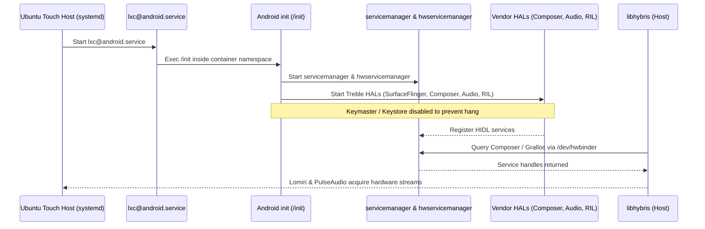

# Android LXC Container & Init Overrides: Lenovo TB-8505X

**Target Device:** Lenovo Tab M8 HD LTE (`TB-8505X` / `akita_row_call`)  
**Base Platform:** Android 10 (SDK 29)  
**Container Subsystem:** LXC (Linux Containers) on Ubuntu Touch Focal (20.04)

---

## 1. Container Architecture & Startup Sequence

In Ubuntu Touch Halium 10, the Android container does not run a full Android userspace (no Zygote, no System Server, no ActivityManager, no Dalvik/ART virtual machine). Instead, it runs a minimal subset of AOSP services required to support Hardware Abstraction Layers (HALs).



---

## 2. Technical Audit of Android Init Overrides

In [`overlay/system/etc/init/`](file:///home/mreza/Desktop/TB8505X/TB8505X-ubuntutouch/overlay/system/etc/init/), two critical overrides are deployed:

### 1. `keystore.rc`
```rc
service keystore /system/bin/keystore /data/misc/keystore_HYBRIS_DISABLED
    disabled
```
- **Technical Reason:** Android's native `keystore` daemon manages cryptographic keys for user credential encryption, hardware-backed authentication, and CTS-verified security states. It expects Android's full `vold` (volume daemon) and `gatekeeperd` to coordinate keystore authentication. In a minimal Halium container, `vold` is absent. If `keystore` is spawned, it continuously crashes or loops, generating high CPU utilization and blocking subsequent container services.
- **Consequences:** Keystore-dependent Android enterprise encryption is disabled. Ubuntu Touch relies on standard Linux PAM / cryptsetup / systemd-homed for host user security instead of Android keystore.

### 2. `wait_for_keymaster.rc`
```rc
service wait_for_keymaster /system/bin/wait_for_keymaster_HYBRIS_DISABLED
    disabled
```
- **Technical Reason:** On Android 10 MediaTek platforms, `wait_for_keymaster` is invoked in `class early_hal` or `post-fs-data`. It polls the Microtrust Beanpod TEE (`/dev/teei_client`) and waits for `android.hardware.keymaster@4.0-service` to signal cryptographic readiness before allowing file-based encryption (FBE) decryption. Because the full framework never starts, `wait_for_keymaster` never receives the unlock token and blocks the init process indefinitely. This creates a hard deadlock where `class hal` services (Composer, Audio, RIL) are never launched.
- **Consequences:** Disabling `wait_for_keymaster` allows Android `init` to immediately proceed with launching `class hal` services, enabling graphics, sound, and cellular hardware without waiting for non-existent Android keymaster authentication.

---

## 3. LXC Mount and Device Permissions

The container runtime binds host device nodes into the container:
- `/dev/binder`, `/dev/hwbinder`, `/dev/vndbinder`
- `/dev/pvr_sync`, `/dev/pvrsrvkm` (PowerVR GPU)
- `/dev/mtk_disp_mgr`, `/dev/mtkfb_vsync` (Display LCM)
- `/dev/ccci*` (Modem)
- Read-only bind mount of `/vendor` from `/dev/block/mmcblk0p36`
