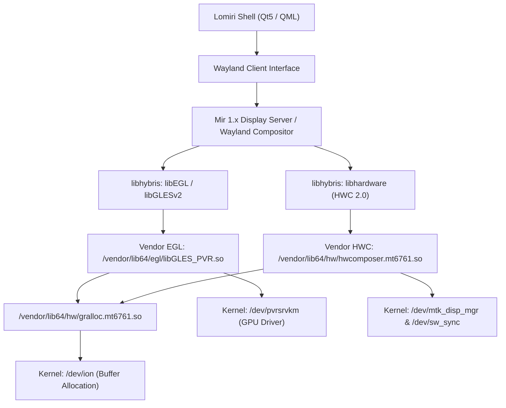

# Architecture & Subsystem Validation — Lenovo TB-8505X

This document provides in-depth technical validation for the **Halium 10 Standalone Adaptation** architecture on the Lenovo TB-8505X, detailing how each hardware subsystem interacts with the GNU/Linux userspace.

---

## 1. Why Halium 10 is the Exact Structural Target

Android devices running Treble separate system from vendor:
- The TB-8505X factory firmware is **Android 10 (SDK 29)**.
- Its vendor HALs (`/vendor/lib64/hw/`) are compiled against **Android 10 Bionic and HIDL interfaces**.
- Halium 9 (Android 9 / SDK 28) expects older HIDL interfaces and lacks support for certain Android 10 Binder token structures.
- Halium 11 (Android 11 / SDK 30) expects dynamic partitions (`super`), AIDL transitions, and newer HIDL descriptor schemas.
- Therefore, **Halium 10 (API Level 29)** is the **exact, mathematically correct abstraction layer** matching the untouched stock vendor partition.

---

## 2. PowerVR Rogue GE8300 & Mir Display Pipeline



### Critical PowerVR Validation Points
1. **Device Nodes & Permissions:**
   The PowerVR driver requires two specific character devices:
   - `/dev/pvrsrvkm` (Permissions: `0666`, owned by `root:root`)
   - `/dev/pvr_sync` (Permissions: `0666`, owned by `root:root`)
   These are enforced in [`configs/udev/70-akita.rules`](file:///home/mreza/Desktop/TB8505X/TB8505X-ubuntutouch/configs/README.md).
2. **Buffer Synchronization & Sync Fences:**
   Mir requires hardware sync fences (`/dev/sw_sync`) to prevent tearing. In the kernel defconfig, `CONFIG_SW_SYNC=y` and `CONFIG_SYNC_FILE=y` must be enabled.
3. **EGL Configuration:**
   libhybris links to `gralloc.mt6761.so` to allocate ashmem/ion graphic buffers matching the 800x1280 resolution.

---

## 3. IPC & Android HAL Communication (gbinder)

Ubuntu Touch uses `libgbinder` to communicate with Android HAL services over Binder IPC without running the full Android framework:

```ini
# /etc/gbinder.conf configuration for akita (Halium 10 / API 29)
[Protocol]
/dev/binder = aidl
/dev/hwbinder = hidl
/dev/vndbinder = hidl

[ServiceManager]
/dev/binder = aidl
/dev/hwbinder = hidl
/dev/vndbinder = hidl

[ApiLevel]
/dev/binder = 29
/dev/hwbinder = 29
/dev/vndbinder = 29
```

- **`servicemanager`:** Handles legacy services (e.g., media/drm).
- **`hwservicemanager`:** Coordinates HIDL HALs (Audio, Bluetooth, Sensors, Light).
- **`vndservicemanager`:** Handles vendor-private interfaces (`android.hardware.*`).

---

## 4. Audio Subsystem (PulseAudio & module-droid-card)

- **Sound Server:** PulseAudio runs in the Ubuntu Touch userspace.
- **HAL Bridge:** PulseAudio loads `module-droid-card.so` which dynamically wraps `/vendor/lib64/hw/audio.primary.mt6761.so`.
- **MediaTek Codec:** Audio output is routed to the MT6357 PMIC via I2S and amplified by the external speaker amplifier (`0x34` on `I2C3`).
- **Known Quirk Mitigation:** Headphone jack insertion does not automatically mute the speaker on MT6761. A udev hook (`/usr/lib/udev/rules.d/`) detects `HEADSET` insertion on `/dev/input/event*` and executes `pactl set-sink-port 0 analog-output-headphones` to switch audio paths.

---

## 5. Wireless Connectivity & Bluetooth

### Wi-Fi (`wlan0`)
- **Driver:** MediaTek `CONSYS_6761` Wi-Fi driver is compiled **directly into the kernel** (`CONFIG_MTK_COMBO_WIFI=y`).
- **Interface:** Presents standard Linux `wlan0` using `cfg80211` / `nl80211`.
- **Userspace:** NetworkManager and `wpa_supplicant` interact directly with `wlan0` through standard Linux sockets. No libhybris bridge is required for Wi-Fi.

### Bluetooth
- **Protocol:** BlueZ standard Linux Bluetooth stack.
- **Bridge:** `bluebinder` acts as a proxy between BlueZ and Android's `android.hardware.bluetooth@1.0-service`.
- **Hardware Address:** Extracted directly from MediaTek NVRAM storage on boot:
  ```bash
  hexdump -s 0 -n 6 -ve '/1 "%02X:"' /vendor/nvdata/APCFG/APRDEB/BT_Addr | sed "s/:$//g" > /var/lib/bluetooth/board-address
  ```

---

## 6. Cellular Telephony & Modem (Ofono)

- **Modem Architecture:** MediaTek MD1 World Mode LTE modem running internal baseband firmware (`md1img`).
- **Driver:** Kernel `ccci` (Cross Core Communication Interface) driver (`/dev/ccci*`).
- **Daemon:** MediaTek `mtkrild` runs inside the Android LXC container.
- **Ofono Plugin:** Ofono connects to `mtkrild` via Binder using the MTK RIL plugin (`/etc/ofono/ril_subscription.d/mtk.conf`).
- **Capabilities:** 4G LTE Data, SMS send/receive, Voice Telephony.
