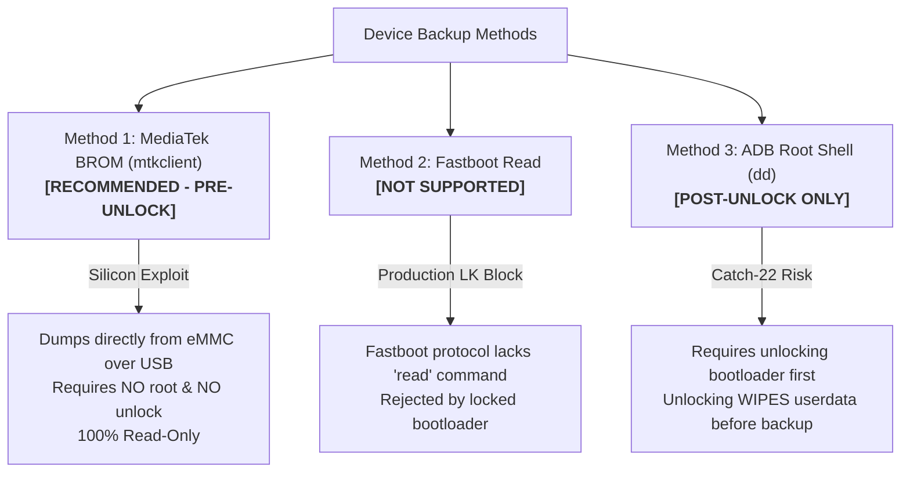

# Device-Specific Backup & Radio Preservation Strategy — Lenovo TB-8505X

## 1. Why Calibration Partitions Require Special Handling

Unlike the operating system partitions (`system`, `vendor`, `boot`) which can be restored from downloaded factory firmware, **the tablet's radio calibration, IMEI, and hardware identity partitions are unique to each physical unit**:

| Partition | Block Device | Size | Critical Content | Recoverable from Stock ROM? |
|---|---|---|---|---|
| `nvram` | `mmcblk0p25` | 64 MiB | Factory IMEI, RF power tables, BT MAC, Wi-Fi MAC | ❌ **NO (Irrecoverable)** |
| `nvdata` | `mmcblk0p7` | 64 MiB | Runtime radio parameters & calibration updates | ❌ **NO (Irrecoverable)** |
| `nvcfg` | `mmcblk0p6` | 32 MiB | NVRAM configuration metadata | ❌ **NO (Irrecoverable)** |
| `proinfo` | `mmcblk0p12` | 3 MiB | Hardware serial number, PCB revision | ❌ **NO (Irrecoverable)** |
| `persist` | `mmcblk0p15` | 48 MiB | Touchscreen & sensor calibration data | ❌ **NO (Irrecoverable)** |
| `protect1` | `mmcblk0p9` | 8 MiB | SIM-lock & modem crypto tokens | ❌ **NO (Irrecoverable)** |
| `protect2` | `mmcblk0p10` | 9.47 MiB | Radio security & identity fallback | ❌ **NO (Irrecoverable)** |
| `seccfg` | `mmcblk0p11` | 8 MiB | Bootloader lock flags & security tokens | ❌ **NO (Irrecoverable)** |
| `preloader` | `mmcblk0boot0/1` | 256 KiB | MediaTek eMMC boot block 0/1 | ❌ **NO (OEM provisioned)** |

> [!CAUTION]
> If `nvram` or `nvdata` are erased or corrupted, the device will report an invalid IMEI, will fail cellular network registration, and cannot be recovered via Lenovo Software Fix or SP Flash Tool.

---

## 2. Comparative Analysis of Acquisition Methods

Three candidate backup methods were investigated:



### Detailed Method Comparison

| Evaluation Metric | Method 1: MediaTek BROM (`mtkclient`) ⭐ | Method 2: Fastboot Dump | Method 3: Post-Root ADB (`dd`) |
|---|---|---|---|
| **Prerequisites** | Linux PC with Python 3, `libusb` | Fastboot USB connection | Booted Android, USB Debugging, Root (`su`) |
| **Requires Unlock?** | **NO.** Works while bootloader is locked. | N/A | **YES.** Requires `fastboot flashing unlock`. |
| **Requires Root?** | **NO.** Operates at silicon boot ROM level. | N/A | **YES.** Requires Magisk or `su`. |
| **Genuinely Read-Only?**| **YES** (when using `mtk r` read command). | N/A | **YES** (for source block nodes via `dd`). |
| **Catch-22 Risk** | **ZERO.** Data is dumped BEFORE any wipe. | N/A | **HIGH.** Unlock erases `/data` before root is gained. |
| **Device Feasibility** | **Verified achievable on MT6761/MT8766.** | **UNSUPPORTED.** LK has no dump command. | Achievable only after unlocking. |

---

## 3. Recommended Procedure: Pre-Unlock BROM Backup (Linux)

Because `mtkclient` executes at the hardware boot ROM level before the bootloader loads, it provides a 100% safe, pre-unlock backup without modifying the tablet:

### Step 1: Install `mtkclient` on Host
```bash
sudo apt-get update
sudo apt-get install -y python3-pip libusb-1.0-0 libusb-1.0-0-dev git
git clone https://github.com/bkerler/mtkclient.git /tmp/mtkclient
cd /tmp/mtkclient && pip3 install -r requirements.txt
```

### Step 2: Set Up Udev Rules (Non-Root USB Access)
```bash
sudo cp /tmp/mtkclient/Setup/Linux/51-edl.rules /etc/udev/rules.d/
sudo udevadm control --reload-rules
sudo udevadm trigger
```

### Step 3: Execute Hardware Dump
1. Create a safe backup directory **OUTSIDE of Git**:
   ```bash
   mkdir -p ~/Desktop/TB8505X/backups/brom_pre_unlock
   ```
2. Power the tablet completely **OFF**.
3. Hold **Volume Up + Volume Down** simultaneously.
4. Plug in the USB cable connected to the Ubuntu laptop.
5. Execute the read command:
   ```bash
   python3 /tmp/mtkclient/mtk r nvram,nvdata,nvcfg,proinfo,persist,protect1,protect2,seccfg,boot,vbmeta ~/Desktop/TB8505X/backups/brom_pre_unlock/
   ```

---

## 4. Backup Verification & Integrity Validation

After the backup is extracted, verify its integrity before any modification:

1. **Size Verification:**
   ```bash
   ls -lh ~/Desktop/TB8505X/backups/brom_pre_unlock/
   ```
   Verify that:
   - `nvram.bin` is exactly 64 MiB (67,108,864 bytes).
   - `nvdata.bin` is exactly 64 MiB (67,108,864 bytes).
   - `nvcfg.bin` is exactly 32 MiB (33,554,432 bytes).
   - `boot.bin` is exactly 32 MiB (33,554,432 bytes).

2. **Non-Zero Entropy Validation:**
   Ensure the images are not blank (all zeroes or all 0xFF):
   ```bash
   python3 -c "
   import sys
   for f in ['nvram.bin', 'proinfo.bin', 'persist.bin']:
       p = f'~/Desktop/TB8505X/backups/brom_pre_unlock/{f}'
       import os; p = os.path.expanduser(p)
       if os.path.exists(p):
           data = open(p, 'rb').read(1024*1024)
           non_zero = sum(1 for b in data if b != 0 and b != 255)
           print(f'{f}: {non_zero} non-trivial bytes in first 1MB')
   "
   ```

3. **Checksum Manifest:**
   ```bash
   cd ~/Desktop/TB8505X/backups/brom_pre_unlock/
   sha256sum *.bin > SHA256SUMS.txt
   ```

---

## 5. Emergency Restoration Procedure

If calibration is damaged or boot fails during porting development:

### Scenario A: Boot Failure / Soft Brick (Fastboot Accessible)
When Little Kernel (LK) fastboot is functional:
```bash
fastboot flash boot /path/to/stock/boot.img
fastboot flash vbmeta /path/to/stock/vbmeta.img
fastboot reboot
```

### Scenario B: Corrupted NVRAM / Lost Radio Calibration (BROM Mode)
When cellular network registration fails or IMEI is wiped:
1. Power tablet OFF completely.
2. Hold **Volume Up + Volume Down**, plug in USB.
3. Restore calibrated radio images using `mtkclient`:
   ```bash
   python3 /tmp/mtkclient/mtk w nvram ~/Desktop/TB8505X/backups/brom_pre_unlock/nvram.bin
   python3 /tmp/mtkclient/mtk w nvdata ~/Desktop/TB8505X/backups/brom_pre_unlock/nvdata.bin
   python3 /tmp/mtkclient/mtk w nvcfg ~/Desktop/TB8505X/backups/brom_pre_unlock/nvcfg.bin
   python3 /tmp/mtkclient/mtk w proinfo ~/Desktop/TB8505X/backups/brom_pre_unlock/proinfo.bin
   python3 /tmp/mtkclient/mtk w persist ~/Desktop/TB8505X/backups/brom_pre_unlock/persist.bin
   python3 /tmp/mtkclient/mtk reset
   ```

### Scenario C: Complete Hardware Flash Restore (SP Flash Tool)
To revert the tablet back to pristine factory state:
1. Open SP Flash Tool with `MTK_AllInOne_DA_6761.bin` and `MT6761_Android_scatter.txt`.
2. Select **Download Only** mode.
3. Power off tablet, hold Volume+, plug USB.
4. Reflash stock factory system, vendor, boot, recovery, and dtbo images.
