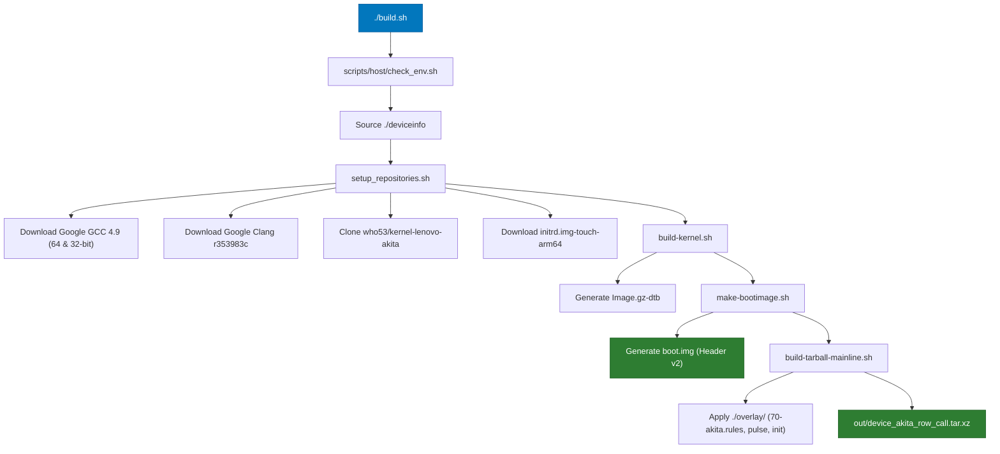

# Ubuntu Touch Adaptation Build Guide — Lenovo TB-8505X

This document provides complete instructions for building the device adaptation, standalone kernel, and installation artifacts for the Lenovo Tab M8 HD (TB-8505X).

---

## 1. Build System Overview

The build architecture uses the official UBports **`halium-generic-adaptation-build-tools`** pipeline, designed for devices running Halium 9, 10, 11, or 12:



---

## 2. Directory Layout & Artifacts

All build outputs are directed to standard directories:

```text
TB8505X-ubuntutouch/
├── build/                 # Upstream halium-generic-adaptation-build-tools engine
├── deviceinfo             # Device specification (offsets, cmdline, repos)
├── build.sh               # Root build wrapper
├── configs/               # udev, pulseaudio, repowerd, and lxc configs
├── overlay/               # Rootfs overlay applied to generated device tarball
│   └── system/
│       ├── etc/           # gbinder.conf, pulse/arm_droid_card_custom.pa
│       └── usr/lib/udev/  # 70-akita.rules
├── patches/               # Kernel and adaptation patches
├── workdir/               # Working build tree (ignored by git)
│   ├── downloads/         # Hermetic compilers (clang, gcc) & kernel tree
│   └── tmp/               # Temporary build staging
└── out/                   # Final build deliverables (ignored by git)
    ├── boot.img           # Standalone Halium boot image (32 MiB)
    └── device_akita_row_call.tar.xz # Adaptation rootfs tarball
```

---

## 3. Step-by-Step Build Instructions

### Step 1: Verify Host Prerequisites
Ensure host dependencies are satisfied:
```bash
./scripts/host/check_env.sh
```

### Step 2: Fetch Repositories & Hermetic Compilers
```bash
./build.sh -c
```
This fetches the Android hermetic toolchains (`clang-r353983c`, `aarch64-linux-android-4.9`) and downstream kernel source without initiating compilation.

### Step 3: Compile Kernel & Generate Boot Image
```bash
./build.sh -k
```
- Applies `akita_row_call_defconfig`.
- Compiles `Image.gz-dtb` using Clang 9.0.3.
- Combines the kernel with `initrd.img-touch-arm64` into `workdir/tmp/partitions/boot.img`.

### Step 4: Full Adaptation Packaging
```bash
./build.sh
```
Executes the full pipeline, creating `out/device_akita_row_call.tar.xz` containing all udev rules, PulseAudio configurations, Android init stubs, and kernel modules.

---

## 4. Reproducibility & Determinism

- **Zero Host Toolchain Leakage:** The build script explicitly prefixes the `PATH` with the downloaded hermetic Clang and GCC binaries.
- **Fixed Clang Revision:** Fixed to `r353983c` matching the factory compiler banner extracted from the physical tablet.
- **SHA-256 Manifesting:** All generated artifacts in `out/` are checksummed and verified prior to deployment.
