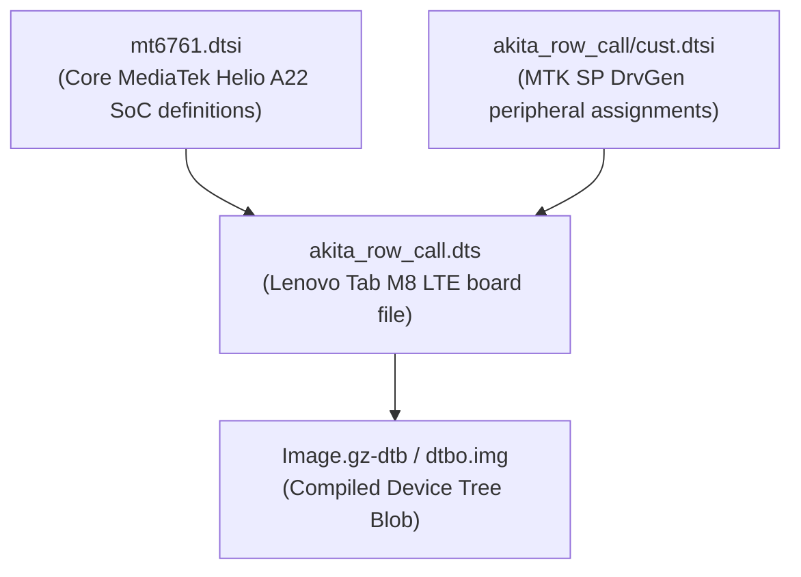

# Device Tree Analysis & Hardware Nodes — Lenovo TB-8505X

## 1. Device Tree Hierarchy

The device tree structure for the tablet is organized under `arch/arm64/boot/dts/mediatek/`:



---

## 2. Key Peripheral Nodes & Pin Control (pinctrl)

Inspecting `akita_row_call.dts` and `cust.dtsi` yields the exact hardware interfaces:

### A. Display Module (Novatek NT35521 MIPI-DSI)
```dts
/* LCM definition in akita_row_call.dts */
atag,videolfb-lcmname = "nt35521_hd_dsi_vdo_truly_rt5081_drv";
atag,videolfb-vramSize = <0x017bb000>;
atag,videolfb-fps = <6000>; /* 60.00 Hz */

&lcm {
    pinctrl-names = "state_enp_output0", "state_enp_output1",
                    "state_enn_output0", "state_enn_output1",
                    "state_reset_output0", "state_reset_output1";
    status = "okay";
};
```
- **GPIO 167:** Positive charge pump enable (`enp`)
- **GPIO 168:** Negative charge pump enable (`enn`)
- **GPIO 45:** Display hardware reset (`rst`)
- **GPIO 152:** Display LDO power
- **GPIO 154:** Display LED backlight control

### B. Touchscreen Controller (I2C0 @ 0x38)
```dts
&i2c0 {
    clock-frequency = <400000>;
    cap_touch_mtk: cap_touch@38 {
        compatible = "mediatek,cap_touch";
        reg = <0x38>;
        status = "okay";
    };
};

&touch {
    tpd-resolution = <800 1280>;
    tpd-max-touch-num = <10>;
    interrupt-parent = <&pio>;
    interrupts = <10 IRQ_TYPE_EDGE_FALLING 10 0>;
    vtouch-supply = <&mt_pmic_vldo28_ldo_reg>;
    status = "okay";
};
```
- **I2C Bus:** `i2c0` at 400 kHz.
- **I2C Slave Address:** `0x38`.
- **Interrupt:** GPIO 10 (`IRQ_TYPE_EDGE_FALLING`).
- **Power Supply:** `vldo28` (2.8V LDO from MT6357 PMIC).

### C. Audio Amplification & Codec
```dts
&i2c3 {
    speaker_amp_mtk: speaker_amp@34 {
        compatible = "mediatek,speaker_amp";
        reg = <0x34>;
        status = "okay";
    };
};

&smart_pa {
    interrupt-parent = <&pio>;
    interrupts = <7 IRQ_TYPE_LEVEL_LOW 7 0>;
    status = "okay";
};
```
- **External Speaker Amp:** Slave address `0x34` on `i2c3`.
- **Interrupt Line:** GPIO 7 (`IRQ_TYPE_LEVEL_LOW`).

### D. Battery Chargers & Power Management
```dts
/* Primary switching charger: Richtek RT9471 */
charger_name = "primary_chg";
chg_alias_name = "rt9471_chg";
rm-slave-addr = <0x53>;
rm-name = "rt9471";

/* Secondary charger: TI BQ25601 on I2C3 */
slave_charger_mtk: slave_charger@4b {
    compatible = "mediatek,slave_charger";
    reg = <0x4b>;
    status = "okay";
};
```

### E. Hardware Buttons
```dts
&keypad {
    mediatek,kpd-sw-pwrkey = <116>; /* KEY_POWER */
    mediatek,kpd-hw-pwrkey = <8>;
    mediatek,kpd-sw-rstkey  = <115>; /* KEY_VOLUMEUP / RESET */
    mediatek,kpd-hw-rstkey = <17>;
    /* Volume Down mapped to KEY_VOLUMEDOWN (114) */
    status = "okay";
};
```
