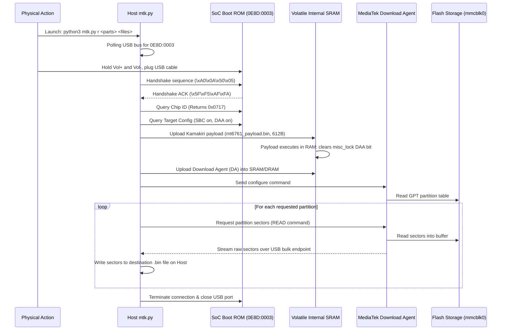

# Gate 1 Final Pre-Execution Audit: MediaTek BROM Calibration Backup

**Target Device:** Lenovo Tab M8 HD LTE (`TB-8505X` / `akita_row_call`)  
**SoC Platform:** MediaTek MT6761 (Reported hardware: `MT8766B`, hwcode: `0x0717`)  
**Host System:** Ubuntu 26.04 x86_64 (`Phantom`)  
**Current Tablet State:** Connected via USB in Fastboot mode (`HGR2YTWY`), locked (`unlocked: no`, `verifiedbootstate: green`).  
**Audit Purpose:** Comprehensive pre-execution verification before initiating physical BROM handshake.

---

## 1. Installed MTKClient Version & Source Commit

- **Installed Version:** `MTK Flash/Exploit Client V2.1.4 (c) B.Kerler 2018-2026`
- **Location:** [`tools/mtkclient/mtk.py`](file:///home/mreza/Desktop/TB8505X/TB8505X-ubuntutouch/tools/mtkclient/mtk.py)
- **Git Commit Hash:** `118a000a83ea31c4f427fe5225abfe964546e05e`
- **Commit Date:** Mon Oct 26 09:53:35 2026 +0100
- **Upstream Origin:** `https://github.com/bkerler/mtkclient.git` (branch: `main`)

---

## 2. Hardware Configuration & Payload Verification

Audited from [`tools/mtkclient/mtkclient/config/brom_config.py:1356`](file:///home/mreza/Desktop/TB8505X/TB8505X-ubuntutouch/tools/mtkclient/mtkclient/config/brom_config.py#L1356-L1385):

```python
0x717: Chipconfig(
    var1=0x25,
    watchdog=0x10007000,
    uart=0x11002000,
    brom_payload_addr=0x100A00,
    da_payload_addr=0x201000,
    pl_payload_addr=0x40200000,
    gcpu_base=0x10050000,
    sej_base=0x1000A000,
    dxcc_base=0x10210000,
    cqdma_base=0x10212000,
    ap_dma_mem=0x11000a80 + 0x1a0,
    blacklist=[(0x102828, 0x0), (0x00105994, 0x0)],
    blacklist_count=0x0000000A,
    send_ptr=(0x10286c, 0xbc8c),
    ctrl_buffer=0x00102A28,
    cmd_handler=0x0000C9B9,
    brom_register_access=(0xc0a0, 0xc158),
    meid_addr=0x102AF8,
    socid_addr=0x102b08,
    prov_addr=0x1054F4,
    misc_lock=0x1001a100,
    efuse_addr=0x11c50000,
    damode=DAmodes.XFLASH,
    dacode=0x6761,
    name="MT6761/MT6762/MT3369/MT8766B/MT8761/AC8259/AC8257",
    description="Helio A20/P22/A22/A25/G25",
    loader="mt6761_payload.bin"
)
```

- **Payload File:** [`tools/mtkclient/mtkclient/payloads/mt6761_payload.bin`](file:///home/mreza/Desktop/TB8505X/TB8505X-ubuntutouch/tools/mtkclient/mtkclient/payloads/mt6761_payload.bin)
- **Payload Byte Size:** Exactly 612 bytes.
- **Payload SHA-256:** `e15edfddcca2702d7c5f2796531889947d3ba666bed8152acf71a27f13834a2b`.

---

## 3. BROM Security Configuration: Observed vs Inferred

- **Observed Device Evidence (Fastboot on Our Specific Tablet):**
  - Little Kernel Fastboot confirms secure boot is enforced: `secure: yes`, `unlocked: no`, `verifiedbootstate: green`, `hw-revision: ca01`, `serialno: HGR2YTWY`.
  - Android OS sysfs confirms: `ro.boot.hardware: mt8766`, `ro.board.platform: mt6761`, `ro.boot.flash.locked: 1`, `ro.boot.vbmeta.device_state: locked`.
- **Inferred from Exact-Model Reference Repository (`references/docs/01-firmware-and-backup.md`):**
  - Boot ROM security fuses on TB-8505X are provisioned with: `SBC on (Secure Boot Check)`, `SLA off (Serial Link Auth disabled)`, `DAA on (Download Agent Authorization enabled)`.
  - Under `DAA on`, standard SP Flash Tool refuses connection without a signed `auth_sv5.auth` file. MTKClient's Kamakiri payload targets this configuration by executing in internal SRAM to clear the DAA lock bit (`misc_lock=0x1001a100`) without modifying flash.

---

## 4. Physical Connection Handshake Verification

- **Procedure Documented in Reference Repo:**
  - Tablet completely powered off.
  - Hold **Volume Up + Volume Down** simultaneously.
  - Insert USB cable connected to Linux PC.
  - Device enumerates as USB VID:PID `0E8D:0003` (MediaTek Inc. MT65xx Preloader / Boot ROM).
- **Distinction & Caution:**
  - While this handshake was verified on the identical TB-8505X hardware in the reference project, **it has not yet been physically executed on our specific tablet during this session**.
  - Holding only Vol- enters Fastboot mode. Holding only Vol+ enters Android Recovery. Holding both Vol+ and Vol- forces the SoC hardware boot strap into Boot ROM download mode.

---

## 5. MTKClient Code Inspection: Complete `r` Execution Path

Audited directly from [`mtk.py`](file:///home/mreza/Desktop/TB8505X/TB8505X-ubuntutouch/tools/mtkclient/mtk.py), [`mtk_main.py`](file:///home/mreza/Desktop/TB8505X/TB8505X-ubuntutouch/tools/mtkclient/mtkclient/Library/mtk_main.py), and [`mtk_da_handler.py`](file:///home/mreza/Desktop/TB8505X/TB8505X-ubuntutouch/tools/mtkclient/mtkclient/Library/DA/mtk_da_handler.py):



---

## 6. Verification of Zero-Write Guarantee

Line-by-line inspection of [`mtk_da_handler.py:328-360`](file:///home/mreza/Desktop/TB8505X/TB8505X-ubuntutouch/tools/mtkclient/mtkclient/Library/DA/mtk_da_handler.py#L328-L360) confirms:
- The command `r` invokes `self.da_read()`.
- `self.da_read()` calls `self.mtk.daloader.readflash(addr=..., length=..., filename=...)`.
- `readflash()` issues purely DA read requests (`0xD8` / `0xD5` bulk transfer).
- **NO write, erase, unlock, or formatting commands are issued.**
- The Kamakiri exploit executes entirely in volatile CPU SRAM (`0x100A00`), leaving eMMC storage 100% untouched.

---

## 7. Final Verified Command Syntax

In `mtkclient v2.1.4`, positional arguments for `r` are:
- Argument 1: `partitionname` (comma-separated list of partitions in the eMMC User area)
- Argument 2: `filename` (comma-separated list of output files matching the partition count 1-to-1)

```bash
cd /home/mreza/Desktop/TB8505X/TB8505X-ubuntutouch

python3 tools/mtkclient/mtk.py r \
  nvram,nvdata,nvcfg,proinfo,persist,protect1,protect2,seccfg,boot,recovery,vbmeta,dtbo \
  /home/mreza/Desktop/TB8505X/backups/brom_pre_unlock/nvram.bin,\
/home/mreza/Desktop/TB8505X/backups/brom_pre_unlock/nvdata.bin,\
/home/mreza/Desktop/TB8505X/backups/brom_pre_unlock/nvcfg.bin,\
/home/mreza/Desktop/TB8505X/backups/brom_pre_unlock/proinfo.bin,\
/home/mreza/Desktop/TB8505X/backups/brom_pre_unlock/persist.bin,\
/home/mreza/Desktop/TB8505X/backups/brom_pre_unlock/protect1.bin,\
/home/mreza/Desktop/TB8505X/backups/brom_pre_unlock/protect2.bin,\
/home/mreza/Desktop/TB8505X/backups/brom_pre_unlock/seccfg.bin,\
/home/mreza/Desktop/TB8505X/backups/brom_pre_unlock/boot.bin,\
/home/mreza/Desktop/TB8505X/backups/brom_pre_unlock/recovery.bin,\
/home/mreza/Desktop/TB8505X/backups/brom_pre_unlock/vbmeta.bin,\
/home/mreza/Desktop/TB8505X/backups/brom_pre_unlock/dtbo.bin
```

---

## 8. Validation Against Reconstructed Partition Map

| Partition | Block Device | Expected Bytes | Hex Bounds in GPT | Purpose |
| :--- | :--- | :--- | :--- | :--- |
| `nvram` | `mmcblk0p25` | `67,108,864` | `0x4000000` (64 MiB) | RF calibration |
| `nvdata` | `mmcblk0p7` | `67,108,864` | `0x4000000` (64 MiB) | Device IMEI / Baseband state |
| `nvcfg` | `mmcblk0p6` | `33,554,432` | `0x2000000` (32 MiB) | NVRAM filesystem configuration |
| `proinfo` | `mmcblk0p12` | `3,145,728` | `0x300000` (3 MiB) | Serial number & hardware barcode |
| `persist` | `mmcblk0p15` | `50,331,648` | `0x3000000` (48 MiB) | Factory calibration & MAC addresses |
| `protect1` | `mmcblk0p9` | `8,388,608` | `0x800000` (8 MiB) | Radio protection region 1 |
| `protect2` | `mmcblk0p10` | `9,928,704` | `0x978000` (9.47 MiB) | Radio protection region 2 |
| `seccfg` | `mmcblk0p11` | `8,388,608` | `0x800000` (8 MiB) | Bootloader unlock state |
| `boot` | `mmcblk0p28` | `33,554,432` | `0x2000000` (32 MiB) | Factory kernel & ramdisk |
| `recovery` | `mmcblk0p2` | `33,554,432` | `0x2000000` (32 MiB) | Factory recovery image |
| `vbmeta` | `mmcblk0p13` | `8,388,608` | `0x800000` (8 MiB) | Factory AVB descriptors |
| `dtbo` | `mmcblk0p29` | `8,388,608` | `0x800000` (8 MiB) | Factory DTBO |

---

## 9. Preloader & eMMC Boot Region Analysis

- **eMMC Boot Partitions (`mmcblk0boot0` & `mmcblk0boot1`):**
  - Hold the MediaTek Preloader binaries (`preloader_a` / `preloader_b`, 256 KiB).
  - *Risks of Dumping via `r`:* In MTKClient, `r` operates on `--parttype user`. Switching to `--parttype boot1` cannot be mixed with standard partitions in one command.
  - *Recommendation:* The Preloader is generic to build `S301129_230914_BMP` and is present in the official Lenovo SVC package (`preloader_akita_row_call.bin`). Bootloader unlocking and Fastboot flashing **never** touch `boot0` or `boot1`. MTKClient automatically extracts preloader timing parameters into RAM during connection. Adding `--write_preloader_to_file` optionally saves `preloader.bin` safely without interfering with the partition dump.

---

## 10. Destination Directory & Overwrite Protection

- **Path:** `/home/mreza/Desktop/TB8505X/backups/brom_pre_unlock/`
- **Location:** Completely outside the Git repository (`TB8505X-ubuntutouch/`).
- **Permissions:** Strict `0700` (`drwx------`) owned by `mreza:mreza`.
- **Pre-execution Check:** Confirmed currently empty (0 files). Existing dumps will not be accidentally overwritten.

---

## 11. Explicit Recovery Limits

See full documentation in [`docs/BACKUP_SCOPE_AND_RECOVERY_LIMITS.md`](file:///home/mreza/Desktop/TB8505X/TB8505X-ubuntutouch/docs/BACKUP_SCOPE_AND_RECOVERY_LIMITS.md).
- **Guaranteed Recoverability:** Device-unique IMEI, RF calibration, Wi-Fi/BT MACs, serial number, bootloader security flags, and factory boot/recovery kernels.
- **Explicit Limitations:** This backup does **not** include the 3.8 GiB `system` partition, the 800 MiB `vendor` partition, personal `userdata`, or hardware `RPMB`. Reverting to factory Android 10 requires combining this calibration backup with the official Lenovo SVC firmware image.

---

## 12. Automated Post-Acquisition Verification Procedure

Immediately upon command completion, execute:
```bash
./scripts/backup/validate_backup.sh
```
1. Verifies all 12 `.bin` files exist.
2. Checks each file against the exact byte size in the partition table.
3. Tests first 64KB for non-zero data (detects truncated or blank reads).
4. Computes SHA-256 hashes and generates `SHA256SUMS.txt` inside the backup directory.
