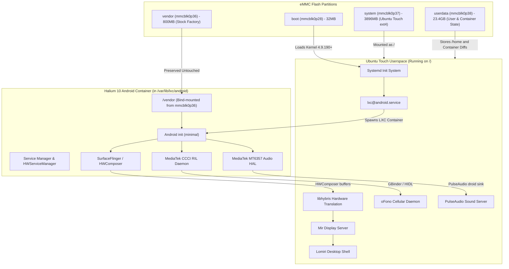

# Halium 10 Architecture & Container Integration: Lenovo TB-8505X

**Target Device:** Lenovo Tab M8 HD LTE (`TB-8505X` / `akita_row_call`)  
**Base Android Version:** Android 10 (SDK 29)  
**Halium Release:** Halium 10  
**UBports Userspace:** Ubuntu 20.04 (Focal Fossa) ARM64

---

## 1. Architectural Overview & Component Distinctions

A common pitfall in Android-based Linux ports is confusing the different images and partitions. On the Lenovo TB-8505X, each component has a precise, strictly separated role:

---

## 2. Component Clarification Matrix

| Component | Physical Location | Content | Purpose |
| :--- | :--- | :--- | :--- |
| **`boot.img`** | `/dev/block/mmcblk0p28` | Monolithic Linux 4.9.190+ kernel + `initrd.img-touch-arm64` | Boots hardware, initializes early mounts, pivots to systemd. |
| **Stock `vendor.img`** | `/dev/block/mmcblk0p36` | Untouched factory Android 10 vendor blobs from Lenovo | Provides MediaTek MT6761 hardware HALs and firmware. |
| **Ubuntu Touch `system.img`** | `/dev/block/mmcblk0p37` | Ubuntu 20.04 ARM64 rootfs + Halium adaptation overlay | Host operating system running Lomiri, Mir, and system services. |
| **Halium Container Image** | `/var/lib/lxc/android/android-rootfs.img` | Minimal AOSP 10 container rootfs | Houses Android `init`, `servicemanager`, and runs HAL daemons. |
| **`userdata`** | `/dev/block/mmcblk0p38` | Formatted ext4 partition | User home directories, app data, and persistent container state. |

---

## 3. LXC Android Container Configuration

The container is spawned via `/lib/systemd/system/lxc@android.service`:
- **Rootfs:** `/var/lib/lxc/android/android-rootfs.img` mounted read-only.
- **Vendor Mount:** Read-only bind mount from host `/vendor` (which mounts `/dev/block/by-name/vendor`).
- **Dev Bindings:** `/dev/binder`, `/dev/hwbinder`, `/dev/vndbinder`, `/dev/pvr_sync`, `/dev/pvrsrvkm`, `/dev/mtk_disp_mgr`, `/dev/ccci*`.
- **Cgroups & Namespaces:** The container runs in isolated mount, UTS, IPC, and PID namespaces while sharing the network and IPC devnodes with the host.
