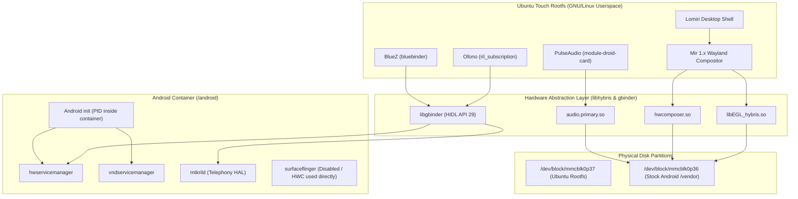

# Halium 10 Standalone Setup & Integration Guide — Lenovo TB-8505X

This document details the configuration and runtime architecture of the **Halium 10 Android container** on the Lenovo Tab M8 HD (TB-8505X).

---

## 1. Architectural Model

Halium 10 runs underneath Ubuntu Touch as an isolated LXC container that hosts the minimal Android HAL daemons:

---

## 2. Vendor Partition Mounting (`mmcblk0p36`)

Ubuntu Touch does not redistribute proprietary MediaTek blobs. Instead, Halium mounts the device's factory vendor partition directly:

- **Partition Device:** `/dev/block/mmcblk0p36` (800 MiB ext4)
- **Mount Point:** `/android/vendor` inside the container namespace
- **Mount Script:** `/usr/share/halium-overlay/system/bin/mount-android.sh`

---

## 3. Disabling Stalling Android Daemons

Certain Android 10 security daemons fail inside an unconfined container and must be disabled via init overrides:

1. **`keystore` & `wait_for_keymaster`:**
   - Overridden in [`overlay/system/etc/init/keystore.rc`](file:///home/mreza/Desktop/TB8505X/TB8505X-ubuntutouch/overlay/system/etc/init/keystore.rc) and [`wait_for_keymaster.rc`](file:///home/mreza/Desktop/TB8505X/TB8505X-ubuntutouch/overlay/system/etc/init/wait_for_keymaster.rc).
   - Prevents boot hangs waiting for the hardware Beanpod TEE keymaster.
2. **`vendor.keymaster-4-0-beanpod`:**
   - Disabled in [`overlay/system/vendor/etc/init/android.hardware.keymaster@4.0-service.beanpod.rc`](file:///home/mreza/Desktop/TB8505X/TB8505X-ubuntutouch/overlay/system/vendor/etc/init/android.hardware.keymaster@4.0-service.beanpod.rc).
3. **Picture Quality (`vendor.mediatek.hardware.pq@2.2-service`):**
   - Stubbed in [`overlay/system/vendor/etc/init/vendor.mediatek.hardware.pq@2.2-service.rc`](file:///home/mreza/Desktop/TB8505X/TB8505X-ubuntutouch/overlay/system/vendor/etc/init/vendor.mediatek.hardware.pq@2.2-service.rc) to save RAM and avoid display flicker.

---

## 4. Hardware Node Permissions & Rules

Enforced via [`overlay/system/usr/lib/udev/rules.d/70-akita.rules`](file:///home/mreza/Desktop/TB8505X/TB8505X-ubuntutouch/overlay/system/usr/lib/udev/rules.d/70-akita.rules):
- `/dev/pvrsrvkm`: Mode `0666` (PowerVR GPU driver)
- `/dev/pvr_sync`: Mode `0666` (PowerVR frame synchronization)
- `/dev/sw_sync`: Mode `0660`, group `android_graphics`
- `/dev/ion`: Mode `0666` (Graphics memory buffer allocator)
- `/dev/binder`, `/dev/hwbinder`, `/dev/vndbinder`: Mode `0666` (IPC channels)
