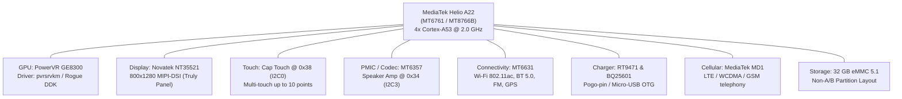

# Hardware Analysis & Architecture — Lenovo TB-8505X

## 1. Executive Identification Summary

The target tablet is the **Lenovo Tab M8 HD (2nd Gen, LTE)**, model number **TB-8505X**.

### Clarification: MT6761 vs. MT8766 vs. `akita_row_call`

A critical source of confusion in MediaTek devices is the coexistence of multiple SoC and board strings. The interrogation of the physical device (`getprop.txt`, `cpuinfo.txt`, `fastboot.txt`) and kernel device tree confirms the exact relationship:

| Property | Value | Architectural Meaning |
|---|---|---|
| `ro.board.platform` | `mt6761` | Underlying silicon architecture: **MediaTek Helio A22**. All BSP drivers, HALs, and register bases use the `mt6761` tree. |
| `ro.boot.hardware` / `/proc/cpuinfo` | `mt8766` / `MT8766B` | MediaTek's tablet-specific marketing identifier and silicon stepping for the MT6761 family. |
| `ro.product.board` / Fastboot `product` | `akita_row_call` | Lenovo board codename: **Akita** (Tab M8 HD), **ROW** (Rest of World / Global firmware), **CALL** (LTE voice telephony enabled). |

> **Key Finding:** For all driver, kernel compilation, and Halium purposes, the target platform is **`mt6761`** targeting board configuration **`akita_row_call`**. The `mt8766` string is a hardware packaging designation that uses the MT6761 core silicon.

---

## 2. Complete Hardware Component Matrix

Based on actual inspection of device tree sources (`akita_row_call.dts`, `cust.dtsi`) and live device properties:

### Detailed Component Specifications

| Subsystem | Hardware Component | Interface / Details | Linux / Halium Status |
|---|---|---|---|
| **CPU** | 4x ARM Cortex-A53 | Up to 2.0 GHz, ARMv8-A 64-bit | Fully supported |
| **GPU** | Imagination PowerVR GE8300 | Rogue DDK, `pvrsrvkm`, GLES 3.2 | Supported via libhybris / Wayland |
| **Display Panel** | Novatek NT35521 MIPI-DSI | 800 x 1280 HD, Truly LCM, 60 Hz | Native kernel driver supported |
| **Touchscreen** | Capacitive Touch IC | Address `0x38` on `I2C0`, IRQ GPIO 10 | Standard Linux input event node |
| **Audio Codec** | MediaTek MT6357 PMIC + Amp | I2S to MT6357, I2C3 Amp @ `0x34` | PulseAudio module-droid-card |
| **Wi-Fi** | MediaTek MT6631 | SDIO / direct kernel wlan0 | Standard `wpa_supplicant` |
| **Bluetooth** | MediaTek MT6631 | UART / Bluebinder to Android HAL | Supported via `bluebinder` |
| **Battery & Charging** | Richtek RT9471 / TI BQ25601 | Switching charger, 5000 mAh Li-Po | Kernel power_supply class |
| **Cameras** | Rear: 5 MP / Front: 2 MP | MIPI-CSI via MediaTek ISP | Experimental in Ubuntu Touch |
| **Sensors** | Accelerometer, Ambient Light | MediaTek Sensor Hub (`sensorfw`) | Supported via `hadess-sensorfw-proxy` |
| **Cellular Modem** | MediaTek MD1 World Mode | CCCI interface / RILD Binder | Supported via Ofono (`mtk.conf`) |
| **Storage** | 32 GB eMMC 5.1 | `/dev/block/mmcblk0` | Ext4 direct partitions |

---

## 3. GPU Architecture & libhybris Compatibility

The PowerVR GE8300 GPU utilizes Imagination Technologies Rogue architecture.
- MediaTek's proprietary driver package provides `pvrsrvkm.ko` (kernel space) and userspace libraries:
  - `gralloc.mt6761.so`
  - `libGLES_PVR.so`
  - `hwcomposer.mt6761.so`
- In Ubuntu Touch, Lomiri runs as a Wayland client on top of the Mir display server.
- Mir communicates with Android's Hardware Composer (HWC2) via `libhybris`.
- Previous porting precedents (such as the Lenovo Tab M10 and Volla Phone) establish that PowerVR Rogue drivers work stably under modern Mir/Wayland when sync fences and EGL buffer formats are correctly matched in `70-akita.rules`.
