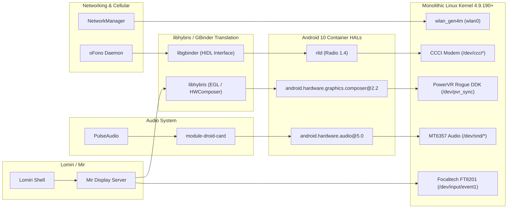

# Hardware Subsystem Integration & Service Chains: Lenovo TB-8505X

**Target Device:** Lenovo Tab M8 HD LTE (`TB-8505X` / `akita_row_call`)  
**Host Stack:** Ubuntu Touch (Ubuntu 20.04 LTS / Lomiri / Mir)  
**Hardware Layer:** MediaTek MT8766B / MT6761 (Android 10 HALs)

---

## 1. Hardware Service Integration Matrix

---

## 2. Subsystem Integration Details

### 1. Display and 3D Graphics
- **Screen Dimensions:** 800 × 1280 pixels, portrait orientation native.
- **Kernel Interface:** `/dev/pvr_sync`, `/dev/pvrsrvkm`, `/dev/mtk_disp_mgr`.
- **Userspace Acceleration:** Mir utilizes `libhybris` to link with `/vendor/lib64/hw/gralloc.mt6761.so` and `hwcomposer.mt6761.so`. EGL rendering is provided by PowerVR Rogue GE8300 blobs.
- **udev Permissions:** Assigned to group `video` (`0660` / `0666`).

### 2. Touch Digitizer
- **Hardware:** Focaltech FT8201 In-cell Touchscreen.
- **Kernel Node:** `/dev/input/event1`.
- **Integration:** Mir input subsystem directly polls `/dev/input/event1` using `libinput`. Orientation matches LCD orientation without coordinate rotation matrices.

### 3. Audio & PMIC
- **Hardware:** MediaTek MT6357 PMIC Audio Codec.
- **Kernel ALSA:** Card 0 (`/dev/snd/pcmC0D0p` speaker out, `pcmC0D0c` mic in).
- **PulseAudio Integration:** Configured via [`overlay/system/etc/pulse/arm_droid_card_custom.pa`](file:///home/mreza/Desktop/TB8505X/TB8505X-ubuntutouch/overlay/system/etc/pulse/arm_droid_card_custom.pa). PulseAudio loads `module-droid-card` to talk to MediaTek's `android.hardware.audio@5.0-service-mediatek`.

### 4. Wi-Fi & Bluetooth
- **Hardware:** MediaTek MT6631 Combo.
- **Wi-Fi Interface:** Standard Linux `wlan0` netdev managed directly by `NetworkManager` and `wpa_supplicant`. Zero Android container involvement required.
- **Bluetooth:** BlueZ communicates with `/dev/stpbt` via WMT protocol.

### 5. Cellular Modem & Data (LTE)
- **Hardware:** MediaTek MT6761 Integrated LTE Cat-4 Baseband.
- **Kernel Interface:** MediaTek CCCI (`/dev/ccci*`).
- **Ubuntu Touch Daemon:** `oFono` configured via `gbinder` ([`overlay/system/etc/gbinder.conf`](file:///home/mreza/Desktop/TB8505X/TB8505X-ubuntutouch/overlay/system/etc/gbinder.conf)) to talk to `/vendor/bin/hw/rild` across `/dev/vndbinder`.

### 6. Power Management & Charging
- **Hardware:** MT6357 PMIC.
- **Kernel Interface:** `/sys/class/power_supply/battery`.
- **Ubuntu Touch Daemon:** `powerd` monitors battery voltage, charge percentage, and regulates suspend/resume states.
