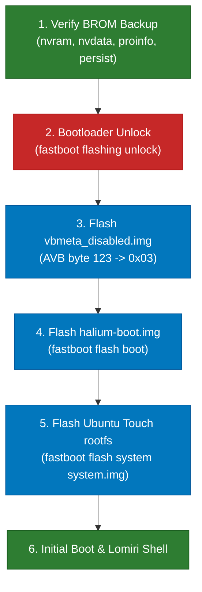

# Ubuntu Touch Installation & Flashing Guide — Lenovo TB-8505X

> [!CAUTION]
> **READ CAREFULLY BEFORE FLASHING:**
> 1. Never flash without completing the pre-unlock MediaTek BROM backup ([`docs/BACKUP_AND_RESTORE.md`](file:///home/mreza/Desktop/TB8505X/TB8505X-ubuntutouch/docs/BACKUP_AND_RESTORE.md)).
> 2. Bootloader unlocking will wipe all user data on the tablet.
> 3. Verify stock firmware availability ([`docs/FIRMWARE_ACQUISITION.md`](file:///home/mreza/Desktop/TB8505X/TB8505X-ubuntutouch/docs/FIRMWARE_ACQUISITION.md)).

---

## 1. Installation Overview



---

## 2. Step 1: Pre-Unlock BROM Backup Verification

Ensure that the unique radio calibration files are safely backed up on the host outside git:

```bash
ls -lh ~/Desktop/TB8505X/backups/brom_pre_unlock/
cd ~/Desktop/TB8505X/backups/brom_pre_unlock/ && sha256sum -c SHA256SUMS.txt
```

---

## 3. Step 2: Bootloader Unlocking

1. Put tablet into Fastboot mode:
   ```bash
   adb reboot bootloader
   ```
2. Request OEM unlock (Requires physical confirmation on tablet):
   ```bash
   fastboot flashing unlock
   ```
3. Press **Volume Up** on the tablet when prompted:
   > *"Press the Volume UP key to confirm unlock (or Volume DOWN to cancel)..."*
4. The device resets and wipes `/userdata`. Boot back into fastboot:
   ```bash
   fastboot devices
   ```
5. Confirm unlock status:
   ```bash
   fastboot getvar unlocked # Must report: unlocked: yes
   ```

---

## 4. Step 3: Flash Verification-Disabled vbmeta

Due to the Fastboot 36.x bug with `--disable-verity`, flash the pre-patched `vbmeta_disabled.img`:

```bash
fastboot flash vbmeta out/vbmeta_disabled.img
```

---

## 5. Step 4: Flash Halium Boot Image

```bash
fastboot flash boot out/boot.img
```

---

## 6. Step 5: Flash Ubuntu Touch Rootfs

Because the `system` partition on the TB-8505X is a discrete **3.80 GiB** partition (`/dev/block/mmcblk0p37`), flash the sparse rootfs image directly:

```bash
fastboot flash system out/system.img
```

Reboot into Ubuntu Touch:
```bash
fastboot reboot
```

---

## 7. Emergency Recovery Protocol

If the device fails to boot into Lomiri:

1. Hold **Power + Volume Down** to re-enter Fastboot mode.
2. Restore the verified stock boot and vbmeta images:
   ```bash
   fastboot flash boot /path/to/stock/boot.img
   fastboot flash vbmeta /path/to/stock/vbmeta.img
   fastboot reboot
   ```
3. If fastboot is unresponsive, enter BROM mode (Power off, hold Vol+ and Vol-, plug USB) and restore stock partitions via `mtkclient` or SP Flash Tool.
