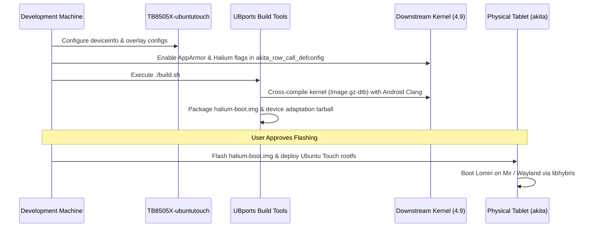

# Porting Strategy & Architectural Evaluation — Lenovo TB-8505X

## 1. Architectural Approaches Comparison

To establish the optimal path for running Ubuntu Touch on the Lenovo TB-8505X, four distinct technical architectures were evaluated:

| Approach | Description | Disk / RAM Required | Feasibility & Pros | Roadblocks & Cons |
|---|---|---|---|---|
| **Approach 1: Full AOSP / LineageOS 17.1 Build** | Compiling full Android 10 userspace and kernel from source with Halium 10 manifest. | >250 GB Disk >16 GB RAM | Total control over all system binaries; full debugging symbols. | Unviable on modern Ubuntu 26 host (Python 3.14/GCC 15 break AOSP 10); massive download and compilation overhead. |
| **Approach 2: Generic Halium GSI** | Flashing an untuned Halium generic system image over stock vendor partition. | ~15 GB Disk ~4 GB RAM | Fast initial flashing attempt without custom build infrastructure. | Frequently bootloops on MediaTek due to missing PowerVR `pvrsrvkm` nodes, Beanpod TEE conflicts, and jack-detect issues. |
| **Approach 3: Standalone Kernel + UBports Generic Adaptation** ⭐ **(RECOMMENDED)** | Compiling downstream Linux 4.9 kernel using prebuilt Android toolchain, packaged via `halium-generic-adaptation-build-tools`. | **~15-25 GB Disk** **~8 GB RAM** | **Canonical UBports workflow** (identical to Lenovo Tab M10 `amar` and `x606` ports); fast reproducible builds; cleanly utilizes stock vendor partition. | Requires assembling accurate `deviceinfo`, udev rules, and AppArmor defconfig patches. |
| **Approach 4: Mainline Linux Kernel** | Upstream Linux kernel without Android container or libhybris. | ~30 GB Disk ~8 GB RAM | Clean modern Linux architecture without proprietary Android blobs. | **Unviable:** MT6761/MT8766 has negligible mainline DTS and driver support; GPU, display, audio, and modem would be non-functional. |

---

## 2. Recommended Approach: Standalone Kernel & Halium 10 Adaptation

### Why Approach 3 is the Engineering Choice

1. **Alignment with UBports Best Practices:** Modern UBports documentation formally deprecated the full system image method in favor of the standalone kernel adaptation model. UBports community ports for related Lenovo MediaTek tablets (`amar_row_wifi`/`amar_row_lte` TB-X306 and `lenovo-x606`) use this exact pipeline.
2. **Resource Efficiency:**
   - Full AOSP 10 synchronization requires downloading >100 GB of git repositories and using >250 GB of disk space.
   - The standalone kernel approach downloads only the kernel tree (~2 GB) and prebuilt Google Android toolchains (~1 GB), building in under 10 minutes.
3. **Host Compatibility on Ubuntu 26:**
   - Standalone kernel compilation utilizes Google's prebuilt hermetic Clang/GCC toolchains (`aarch64-linux-android-4.9` and `clang-r353983c`), avoiding Python 3.14 / GCC 15 host incompatibilities.
4. **Preservation of Stock Hardware Support:**
   - TB-8505X has a dedicated `/vendor` partition (`mmcblk0p36`, 800 MB). Stock MediaTek proprietary drivers for the PowerVR GE8300 GPU, MT6631 Wi-Fi, MT6357 audio codec, and cellular baseband remain untouched on disk.

---

## 3. Implementation Workflow

