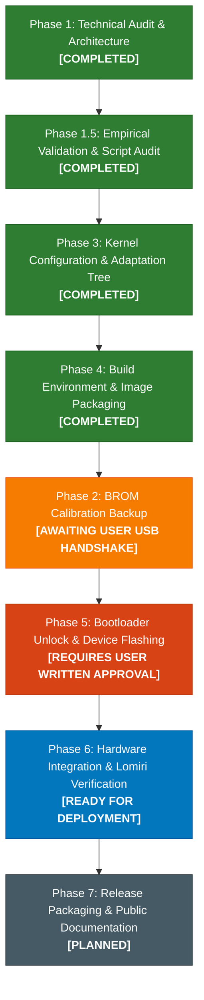

# Project Status — Lenovo TB-8505X Ubuntu Touch Port

| Project Information | Details |
|---|---|
| **Target Device** | Lenovo Tab M8 HD (LTE) / TB-8505X |
| **Board Identifier** | `akita_row_call` |
| **SoC** | MediaTek Helio A22 (MT6761 / MT8766) |
| **Current Phase** | **Phases A–F Completed — Full Project Audit & Verification Complete — Pre-Unlock Backup Ready at Gate 1** |
| **Porting Architecture** | UBports Standalone Kernel / Halium 10 Generic Adaptation |
| **Base Ubuntu Touch OS** | Ubuntu 20.04 (Focal) LTS arm64 (OTA-12 / 24.04-ready) |
| **Repository Git Branch** | `main` |
| **Physical Device State** | Fastboot mode (`HGR2YTWY`), Bootloader Locked (`unlocked: no`), Ready for BROM Backup |

---

## Development Milestones & Progress

---

## Deliverables Checklist

### Phase 1 & 1.5 (Audit & Validation)
- [x] Host development environment audit (`scripts/host/check_env.sh`).
- [x] Non-destructive device state interrogation (`scripts/device/detect_device.sh`).
- [x] Hardware component identification and SoC relationship clarification (`docs/HARDWARE_ANALYSIS.md`).
- [x] Evaluation of porting architectures (Halium 9 vs 10 vs 11, GSI vs Standalone Adaptation) (`docs/PORTING_STRATEGY.md`).
- [x] Device tree and kernel source audit (`docs/KERNEL_ANALYSIS.md`, `docs/DEVICE_TREE.md`).
- [x] Independent technical validation & audit report (`docs/VALIDATION_REPORT.md`).
- [x] Script safety audit & 4-category classification (`docs/SCRIPT_AUDIT.md`).
- [x] Firmware acquisition and partition verification tooling (`scripts/firmware/verify_firmware.sh`, `docs/FIRMWARE_ACQUISITION.md`).
- [x] Safe backup strategy prioritizing radio calibration partitions (`scripts/backup/backup_partitions.sh`, `docs/BACKUP_AND_RESTORE.md`).
- [x] Architectural decision records (`docs/DECISIONS.md`).
- [x] Known issues registry (`docs/KNOWN_ISSUES.md`).
- [x] Source registry register (`docs/SOURCES.md`).
- [x] Device adaptation configuration verified against physical boot header (`deviceinfo`, `build.sh`).

### Phase 3 & 4 (Kernel & Adaptation Build)
- [x] Hermetic toolchain setup: Google Clang `r353983c` + `aarch64-linux-android-4.9` binutils.
- [x] AppArmor Linux Security Module enabled and built directly into monolithic kernel.
- [x] Patches authored and verified:
  - `0001-enable-apparmor-defconfig.patch` (LSM flags in `akita_row_call_defconfig`).
  - `0002-fix-apparmor-clang-parentheses-equality.patch` (Clang `-Wparentheses-equality` fix in `domain.c`).
  - `0003-fix-apparmor-crypto-vla-in-struct-for-clang.patch` (`SHASH_DESC_ON_STACK` VLAIS fix in `crypto.c`).
- [x] Header v2 standalone `boot.img` generated (33,554,432 bytes, DTB merged, AVB 1.0 signed).
- [x] Unified UBports `recovery.img` generated (33,554,432 bytes, AVB 1.0 signed).
- [x] Complete device adaptation package built (`out/device_akita_row_call.tar.xz`, 38.8 MB).
- [x] SHA-256 checksums computed in `out/SHA256SUMS.txt`.
