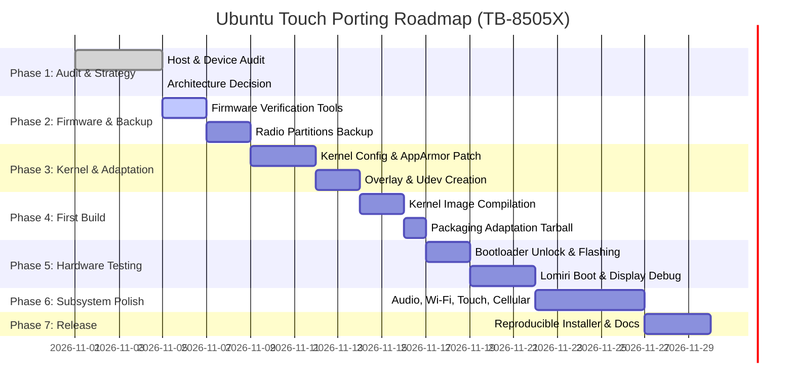

# Project Roadmap & Implementation Schedule — Lenovo TB-8505X

---

## Detailed Milestone Descriptions

### Phase 1: Audit and Research (Completed)
- [x] Host environment compatibility audit (`scripts/host/check_env.sh`).
- [x] Non-destructive device detection script (`scripts/device/detect_device.sh`).
- [x] Detailed hardware and SoC architecture analysis (`docs/HARDWARE_ANALYSIS.md`).
- [x] Porting strategy evaluation and architecture selection (`docs/PORTING_STRATEGY.md`).
- [x] Device tree and partition memory map documentation (`docs/PARTITION_LAYOUT.md`).

### Phase 2: Firmware Acquisition & Backup Strategy (Pre-Unlock)
- [x] Automated firmware verification tooling (`scripts/firmware/verify_firmware.sh`).
- [x] Safe backup utility with dry-run default outside git (`scripts/backup/backup_partitions.sh`).
- [x] Corrected MTKClient 1-to-1 syntax and physical BROM connection documentation (`docs/PRE_UNLOCK_BACKUP_PROCEDURE.md`).
- [x] Automated post-backup size and entropy validation script (`scripts/backup/validate_backup.sh`).
- [ ] User executes pre-unlock BROM backup via `mtkclient`.
- [ ] Automated validation verifies all 12 partition dumps.

### Phase 3: Kernel Configuration & Adaptation Tree (Completed)
- [x] Establish adaptation repository structure (`deviceinfo`, `build.sh`, `overlay/`).
- [x] Clone downstream kernel tree (`who53/kernel-lenovo-akita`).
- [x] Configure `akita_row_call_defconfig` with UBports AppArmor & Halium requirements.
- [x] Assemble overlay files (`70-akita.rules`, `gbinder.conf`, `repowerd`, `pulseaudio`).
- [x] Authored and verified kernel patches (`0001`, `0002`, `0003`).

### Phase 4 & 4.5: First Adaptation Build & Artifact Validation (Completed)
- [x] Set up hermetic Android toolchain (`clang-r353983c` + `aarch64-linux-android-4.9`).
- [x] Compile monolithic Linux 4.9 kernel (zero `=m` modules).
- [x] Package bit-accurate `boot.img` with discrete Halium 10 initramfs.
- [x] Package unified UBports `recovery.img` with root adbd and fastbootd.
- [x] Generate complete adaptation tarball `out/device_akita_row_call.tar.xz`.
- [x] Independent bit-level audit and SHA-256 verification (`docs/ARTIFACT_VALIDATION.md`).
- [x] Component dependency architecture specification (`docs/UBUNTU_TOUCH_IMAGE_ASSEMBLY.md`).

### Phase 5: Device Integration & Initial Boot (Requires Explicit Approval)
- [ ] Request and receive explicit human authorization for bootloader unlock.
- [ ] Unlock bootloader via `fastboot flashing unlock` with hardware Vol+ confirmation.
- [ ] Flash patched `vbmeta_disabled.img`.
- [ ] Flash `boot.img` and deploy generic Halium 10 GSI + Ubuntu Touch rootfs.
- [ ] Capture initial serial/dmesg boot logs and diagnose early userspace.

### Phase 6: Hardware Validation & Lomiri Verification
- [ ] Validate Mir display server on PowerVR GE8300 GPU.
- [ ] Verify multi-touch input responsiveness.
- [ ] Configure audio routing with PulseAudio `module-droid-card`.
- [ ] Verify Wi-Fi network scanning and connection (`wlan0`).
- [ ] Test cellular modem and SMS reception via Ofono.

### Phase 7: Release Preparation & Maintenance
- [ ] Create automated UBports installer configuration.
- [ ] Document complete disaster recovery and re-flashing instructions.
- [ ] Publish supported hardware compatibility matrix.

---

### Phase A–F: Complete Project Audit & Installation Package Assembly (Completed)
- [x] Complete project repository audit and script safety audit ([`docs/BUILD_AUDIT.md`](file:///home/mreza/Desktop/TB8505X/TB8505X-ubuntutouch/docs/BUILD_AUDIT.md)).
- [x] Reconstructed definitive 40-partition physical table from hardware evidence ([`docs/PARTITION_MAP.md`](file:///home/mreza/Desktop/TB8505X/TB8505X-ubuntutouch/docs/PARTITION_MAP.md)).
- [x] Confirmed vs inferred hardware inventory published ([`docs/HARDWARE_INVENTORY.md`](file:///home/mreza/Desktop/TB8505X/TB8505X-ubuntutouch/docs/HARDWARE_INVENTORY.md)).
- [x] Standalone kernel validated against kconfig & binary symbols ([`docs/KERNEL_VALIDATION.md`](file:///home/mreza/Desktop/TB8505X/TB8505X-ubuntutouch/docs/KERNEL_VALIDATION.md)).
- [x] Halium 10 architecture & Android LXC container documented ([`docs/HALIUM_ARCHITECTURE.md`](file:///home/mreza/Desktop/TB8505X/TB8505X-ubuntutouch/docs/HALIUM_ARCHITECTURE.md), [`docs/ANDROID_CONTAINER.md`](file:///home/mreza/Desktop/TB8505X/TB8505X-ubuntutouch/docs/ANDROID_CONTAINER.md)).
- [x] Stock vendor preservation strategy and blob dependencies audited ([`docs/VENDOR_BLOBS.md`](file:///home/mreza/Desktop/TB8505X/TB8505X-ubuntutouch/docs/VENDOR_BLOBS.md)).
- [x] Integrated `recovery.fstab` into `recovery.img` ramdisk via overlay.
- [x] Automated package validator authored and executed ([`scripts/validate_installation_package.sh`](file:///home/mreza/Desktop/TB8505X/TB8505X-ubuntutouch/scripts/validate_installation_package.sh)).
- [x] Comprehensive Pre-Flash Review published ([`docs/PRE_FLASH_REVIEW.md`](file:///home/mreza/Desktop/TB8505X/TB8505X-ubuntutouch/docs/PRE_FLASH_REVIEW.md)).
- [ ] Gate 1: User approves and initiates pre-unlock BROM acquisition.
- [ ] Gate 2: User approves and executes bootloader unlock.
- [ ] Gate 3: Flash `boot`, `recovery`, `vbmeta`, and deploy Ubuntu Touch rootfs.
