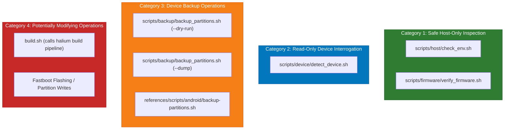

# Script Audit & Safety Classification Report — Lenovo TB-8505X

**Date:** 2026-11-05  
**Auditor:** Autonomous Platform & Embedded Systems Engineer  
**Target Repository:** `TB8505X-ubuntutouch`  
**Physical Target:** Lenovo Tab M8 HD (TB-8505X / `akita_row_call`)  

---

## 1. Safety Audit Policy

Before executing any script on the development host or communicating with the physical tablet, each script must undergo a complete static and dynamic analysis covering:
1. **Inputs & Outputs:** What files, environment variables, and hardware interfaces does it read and write?
2. **Privilege Requirements:** Does it require host root (`sudo`) or device root (`su`)?
3. **Hardware Communication:** Does it communicate over ADB, Fastboot, USB raw endpoints, or BROM?
4. **State Modification Risk:** Can it modify partition tables, flash memory, bootloader locks, or file contents?
5. **Error Handling & Fault Tolerance:** Does it enforce strict error trapping (`set -euo pipefail`), validate prerequisites, and prevent partial execution?
6. **Information Leakage Prevention:** Does it sanitize, redact, or exclude device serial numbers, IMEI, Wi-Fi/BT MAC addresses, and private radio calibration dumps?

---

## 2. Script Classification Matrix

All scripts in the project repository and reference repository are classified into four distinct operational safety categories:

---

## 3. Detailed Script Audits

### 3.1 Category 1: Safe Host-Only Inspection

#### `scripts/host/check_env.sh`
* **Purpose:** Inspect host development machine architecture, available RAM, disk space, and essential cross-compilation toolchains.
* **Reads:** `/etc/os-release`, `/proc/meminfo`, `df -k .`, host PATH for CLI tools (`git`, `python3`, `gcc`, `make`, `adb`, `fastboot`, `docker`, `java`, `curl`, `aria2c`).
* **Writes:** None (Standard output only).
* **Requires Host Root:** ❌ No. Runs entirely in unprivileged user space.
* **Requires Device Root:** ❌ No.
* **Tablet Communication:** Passive query only (`fastboot devices`, `adb devices`). Does not send command payloads or state changes.
* **Can Modify Device State:** ❌ No. Read-only host query.
* **Error Handling:** Employs `set -euo pipefail`. Returns exit code `0` when required packages exist; exit code `1` if essential dependencies are missing.
* **Privacy & Secret Sanitization:** Displays generic OS and hardware resource numbers. Does not output device serial numbers.
* **Operational Status:** **SAFE TO RUN FREELY ON HOST.**

---

#### `scripts/firmware/verify_firmware.sh`
* **Purpose:** Validates file completeness, Android boot magic bytes, AVB 2.0 headers, MediaTek scatter file syntax, and SHA-256 sums of stock firmware directories.
* **Reads:** Firmware directory passed as argument (specifically `boot.img`, `vbmeta.img`, `MT6761_Android_scatter.txt`).
* **Writes:** Generates checksum verification manifest `SHA256SUMS-verified.txt` inside the specified firmware directory.
* **Requires Host Root:** ❌ No.
* **Requires Device Root:** ❌ No.
* **Tablet Communication:** ❌ None. Operates completely offline on local firmware archives.
* **Can Modify Device State:** ❌ No.
* **Error Handling:** Employs `set -euo pipefail`. Checks argument count, directory existence, verifies `ANDROID!` (offset 0-7 of `boot.img`), verifies `AVB0` (offset 0-3 of `vbmeta.img`), and parses AVB flag byte at offset 123.
* **Privacy & Secret Sanitization:** Processes generic factory firmware images. No private device keys or serials are processed.
* **Operational Status:** **SAFE TO RUN ON LOCAL FILES.**

---

### 3.2 Category 2: Read-Only Device Interrogation

#### `scripts/device/detect_device.sh`
* **Purpose:** Safely detect connection mode (ADB or Fastboot) and interrogate board product name, bootloader lock state, and running kernel version.
* **Reads:** `fastboot getvar` properties (`product`, `unlocked`, `secure`, `slot-count`, `max-download-size`, `battery-soc-ok`, `version-bootloader`) OR `adb getprop` system properties (`ro.product.model`, `ro.product.board`, `ro.build.display.id`, `sys.oem_unlock_allowed`, `/proc/version`).
* **Writes:** None (Standard output only).
* **Requires Host Root:** ❌ No (requires standard udev permissions for USB device).
* **Requires Device Root:** ❌ No. Uses non-root ADB and Fastboot getvar.
* **Tablet Communication:** Non-destructive query commands only (`getvar`, `getprop`, `cat /proc/version`).
* **Can Modify Device State:** ❌ No. Does not execute flashing, reboot, erase, or write commands.
* **Error Handling:** Employs `set -euo pipefail`. Validates presence of `fastboot` and `adb`. Checks if any device is attached; gracefully exits with code `1` if disconnected.
* **Privacy & Secret Sanitization:** Includes active `sanitize()` filter using regex stream replacement:
  - Redacts `serialno` to `[REDACTED_SERIAL]`
  - Redacts `ro.boot.serialno` and `ro.serialno` to `[REDACTED_SERIAL]`
  - Redacts MAC addresses `([0-9a-fA-F]{2}:){5}[0-9a-fA-F]{2}` to `[REDACTED_MAC]`
* **Operational Status:** **SAFE FOR INTERACTIVE DEVICE INTERROGATION.**

---

### 3.3 Category 3: Device Backup Operations

#### `scripts/backup/backup_partitions.sh`
* **Purpose:** Extract device-unique radio calibration and identity partitions (`nvram`, `nvdata`, `nvcfg`, `proinfo`, `persist`, `protect1`, `protect2`, `seccfg`, `mmcblk0boot0`, `mmcblk0boot1`).
* **Reads:** Raw block devices on tablet `/dev/block/platform/*/by-name/*` and `/dev/block/mmcblk0boot*`.
* **Writes:** Host destination directory (`<output_dir>/*.img` and `SHA256SUMS.txt`), temporary directory on tablet (`/data/local/tmp/tb_backup_tmp/`).
* **Requires Host Root:** ❌ No.
* **Requires Device Root:** ✔️ **YES** (when executed in `--dump` mode via ADB, requires `su` root on tablet). In `--dry-run` mode, no root is required.
* **Tablet Communication:** 
  - `--dry-run`: Checks `adb devices` only.
  - `--dump`: Executes `adb shell su -c 'dd if=... of=...'`, `adb pull`, `adb shell rm -rf`.
* **Can Modify Device State:**
  - Partitions: ❌ **NO**. Block devices are read via `dd if=...`. They are never written to (`of=` targets `/data/local/tmp/` only).
  - Storage: Creates temporary files under `/data/local/tmp/`, which are removed upon completion.
* **Error Handling:**
  - Strict mode `set -euo pipefail`.
  - Default execution mode is `--dry-run`. Dump execution requires explicit `--dump <dir>`.
  - Enforces workspace safety check: **Strictly refuses to dump into any Git-tracked directory** (checks `git rev-parse --is-inside-work-tree` on destination and parent). Exits immediately with error code `1` if violation detected.
  - Generates SHA-256 sums on device before pulling, and automatically verifies them on host via `sha256sum -c`.
* **Privacy & Secret Sanitization:**
  - Outputs sensitive binary calibration files.
  - Guarded by `.gitignore` rules forbidding `*.img`, `*.nvram`, `*.nvdata`, `private/`, `backups/`.
  - Output path must reside outside the repository tree (e.g. `~/Desktop/TB8505X/backups/`).
* **Operational Status:**
  - `--dry-run`: **SAFE TO EXECUTE ANYTIME.**
  - `--dump`: **SAFE READ-ONLY EXTRACTION, BUT REQUIRES ROOTED ANDROID OS.** *(Cannot run in Fastboot or locked state).*

---

#### Reference Script: `references/scripts/android/backup-partitions.sh`
* **Purpose:** Reference shell script designed to be pushed to and executed directly on the Android tablet.
* **Reads:** `/dev/block/platform/*/by-name/*`, `/sys/class/block/*/size`.
* **Writes:** Dumps partition images to `<outdir>/` on device internal storage or SD card.
* **Requires Root:** ✔️ Yes. Requires execution inside an Android root shell (`su`).
* **Safety Evaluation:**
  - Simple `dd` read loop.
  - Skips large OS partitions (`system`, `vendor`, `product`, `userdata`, `cache`, `lenovocust`).
  - Lacks safety checks against running out of disk space on internal storage.
  - Does not prevent accidental placement inside git repos.
* **Recommendation:** **Do not execute directly.** Use the hardened `scripts/backup/backup_partitions.sh` instead, or prefer MediaTek BROM dumping via `mtkclient`.

---

### 3.4 Category 4: Potentially Modifying Operations

#### `build.sh`
* **Purpose:** Top-level build wrapper for UBports standalone adaptation pipeline.
* **Reads:** `deviceinfo`, `scripts/host/check_env.sh`, remote git repositories (`halium-generic-adaptation-build-tools`, `kernel-lenovo-akita`, toolchains).
* **Writes:** Clones build tools into `build/`, downloads toolchains and kernel objects into `workdir/`, produces boot image and rootfs tarball in `out/`.
* **Requires Host Root:** ❌ No.
* **Requires Device Root:** ❌ No.
* **Tablet Communication:** ❌ None during compilation.
* **Can Modify Device State:** ❌ No (compilation only). However, the resulting artifacts (`out/boot.img`, `out/device_akita_row_call.tar.xz`) are intended for subsequent flashing.
* **Error Handling:** Employs `set -euo pipefail`. Invokes host environment preflight check before cloning.
* **Privacy & Secret Sanitization:** Build artifacts do not contain private calibration or device serials.
* **Operational Status:** **SAFE TO EXECUTE FOR HOST BUILD.**

---

#### Fastboot & Flashing Commands (Manual / Scripted)
* **Commands:** `fastboot flashing unlock`, `fastboot flash boot ...`, `fastboot flash vbmeta ...`, `fastboot flash system ...`, `fastboot erase ...`, `fastboot format ...`.
* **Requires Host Root:** ❌ No (requires udev USB rules).
* **Tablet Communication:** High-risk write/erase commands to tablet eMMC flash.
* **Can Modify Device State:** ⚠️ **CRITICAL RISK (STATE MODIFICATION & DATA LOSS)**.
  - `fastboot flashing unlock`: Triggers factory wipe of `/data` and drops AVB integrity level to ORANGE.
  - `fastboot flash <partition>`: Overwrites physical flash sectors.
* **Operational Status:** ⛔ **STRICTLY PROHIBITED UNTIL EXPLICIT USER AUTHORIZATION.**

---

## 4. Script Execution Safety Protocol

To ensure 100% compliance with safety restrictions throughout Phase 2 and Phase 3:

| Phase | Permitted Script Operations | Strictly Prohibited Operations |
|---|---|---|
| **Phase 1.5 / Preflight** | `scripts/host/check_env.sh` `scripts/firmware/verify_firmware.sh` `scripts/device/detect_device.sh` `scripts/backup/backup_partitions.sh --dry-run` | `fastboot flashing unlock` `fastboot flash *` `fastboot erase *` `mtk w *` (write) `mtk da seccfg unlock` |
| **Phase 2 / Backup** | `python3 mtk r <partitions> <dir>` (read-only BROM dump) `sha256sum -c SHA256SUMS.txt` | Any BROM write or erase commands |
| **Phase 3 / Adaptation** | `./build.sh -c` (clone only) `./build.sh -k` (compile kernel only) `./build.sh` (complete package build) | Flashing generated artifacts to device |
| **Phase 5 / Deployment** | Fastboot flashing (ONLY after verified backup and explicit user prompt) | Flashing without verified backup manifest |
