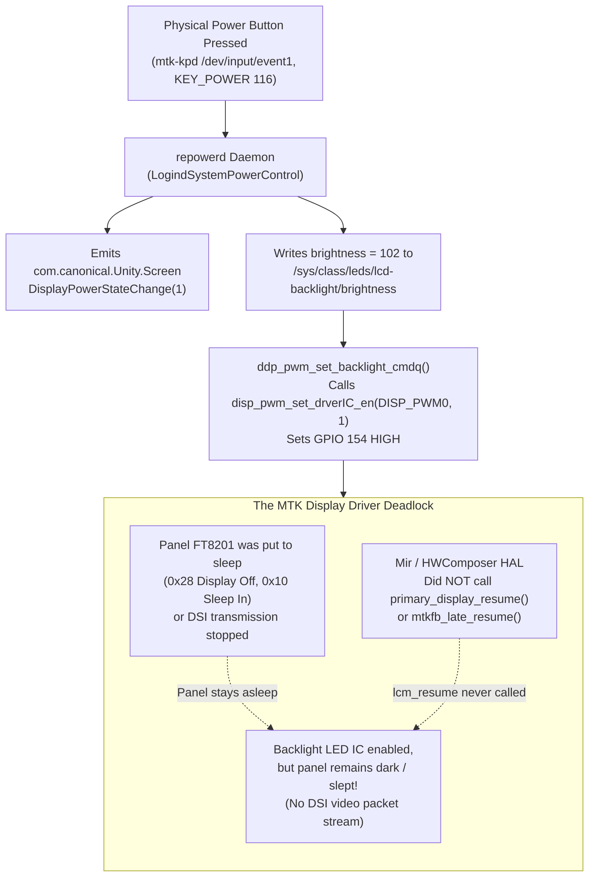
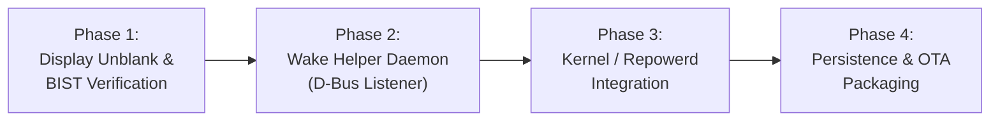

# Lenovo Tab M8 HD LTE (TB-8505X) Ubuntu Touch Sleep/Wake Debugging State & Roadmap

> **Target Audience:** Autonomous LLM coding agents, kernel/BSP engineers, Halium/Ubuntu Touch integrators.  
> **Document Purpose:** Complete state reference, architectural mapping, root-cause diagnostics, and actionable implementation roadmap for resolving the physical sleep/wake "black screen of death" issue.  
> **Last Updated:** 2026-11-06 (Live system verified).

---

## 1. System Overview & Hardware Specifications

| Property | Value / Specification |
|---|---|
| **Device Model** | Lenovo Tab M8 HD LTE (`TB-8505X` / `Lenovo TB-8505X`) |
| **Project Codename** | `akita_row_call` (Variant: `akita_prc_wifi`, `aaron_prc_call`) |
| **SoC** | MediaTek MT6761 (Helio A22 / MT8766B), Quad-core ARM Cortex-A53 @ 2.0 GHz, 64-bit (`aarch64`) |
| **GPU / Display Controller** | IMG PowerVR GE8320 / MTK Direct Display Path (`dispsys` / `mtkfb`) |
| **Panel Model** | FocalTech `FT8201` WXGA In-cell BOE (`ft8201_wxga_vdo_incell_boe`, 800x1280 MIPI-DSI Video Mode) |
| **Power/Bias Management IC** | Richtek/Silicon Mitus `SM5109` / TI `TPS65132` Dual-rail LCD Bias (AVDD +5V, AVEE -5V) |
| **Touch Controller** | FocalTech In-cell Touch (`ft8201` / `focaltech_touch`) |
| **Operating System** | Ubuntu Touch 24.04 (Noble Numbat), systemd-based init |
| **Display Compositor** | `lomiri` / `lomiri-system-compositor` (Mir 2.x) with Halium / libhybris HWComposer wrapper |
| **Power Management Daemon** | `repowerd` (delegated via systemd `logind`, talks to Unity Screen D-Bus service) |

---

## 2. Host & Target Environment Configuration

### Target Network & Access
- **Target USB IP:** `10.15.19.82` (over RNDIS `rndis0`)
- **ADB Status:** Active and authenticated (`GNU/Linux Device on rndis0 10.15.19.82`)
- **Port Forwarding:** SSH forwarded from target port 22 to host port 2222:
  ```bash
  adb forward tcp:2222 tcp:22
  ```
- **Target SSH Access:** Root access using dedicated RSA/ED25519 debug key:
  ```bash
  ssh -o StrictHostKeyChecking=no -o UserKnownHostsFile=/dev/null \
      -i /home/mreza/Desktop/TB8505X/TB8505X-ubuntutouch/out/ota_24_04/ssh_debug_key \
      -p 2222 root@localhost "<COMMAND>"
  ```
- **Target User Passcode:** `8110` (developer mode enabled)
- **Host Workspaces:**
  - Repo root: `/home/mreza/Desktop/TB8505X/TB8505X-ubuntutouch`
  - Workspace parent: `/home/mreza/Desktop/TB8505X`
  - Kernel source tree: `/home/mreza/Desktop/TB8505X/TB8505X-ubuntutouch/workdir/downloads/kernel-lenovo-akita`

> [!CAUTION]
> **Strict Partition Protection Rule:**  
> NEVER touch, erase, or overwrite radio calibration and secure identity partitions:
> - `nvram` (`mmcblk0p14`)
> - `nvdata` (`mmcblk0p15`)
> - `proinfo` (`mmcblk0p16`)
> - `persist` (`mmcblk0p17`)
> - `protect1` (`mmcblk0p18`), `protect2` (`mmcblk0p19`)

---

## 3. The Problem: "Blank Screen of Death" on Wake

### Symptoms Observed
1. The device boots normally into the Lomiri desktop, screen and touch function as expected.
2. When the device screen times out or the physical power button is pressed:
   - The display turns off.
   - Brightness drops to 0.
   - The backlight turns off completely.
3. When the user presses the physical power button to wake the device:
   - The device **does NOT turn the screen back on**. Backlight remains dead black.
   - The charging/notification LED blinks or toggles with each button press (reflecting Lomiri battery/power event hooks).
   - SSH and ADB remain fully alive and responsive.
   - The physical power button events (`KEY_POWER` 116) ARE received by the kernel (`mtk-kpd`).
   - `repowerd` successfully detects the press and transitions to `PowerState = 1` (on), setting `/sys/class/leds/lcd-backlight/brightness` to `102` (40%).
   - Even when brightness is set back to >0 and GPIO 154 is high, the screen stays dark!

---

## 4. Hardware Pinout & GPIO Mapping

Verified against `/home/mreza/Desktop/TB8505X/TB8505X-ubuntutouch/workdir/downloads/kernel-lenovo-akita/arch/arm64/boot/dts/mediatek/akita_row_call.dts` and live `/sys/devices/platform/1000b000.pinctrl/mt_gpio`:

| GPIO Pin | DTS Label | Pinctrl State | Functional Role | Active State |
|---|---|---|---|---|
| **GPIO 45** | `lcm_pins_rst` | `resetoutput0` / `resetoutput1` | LCD Controller Reset (`FT8201` Reset Pin) | HIGH (1) for normal run; LOW (0) for reset |
| **GPIO 152** | `lcm_pins_ldo` | `ldooutput0` / `ldooutput1` | LCD Panel LDO Power Rail Enable | HIGH (1) |
| **GPIO 154** | `lcm_pins_led` | `ledoutput0` / `ledoutput1` | Backlight LED Driver IC Hardware Enable | HIGH (1) to power backlight driver IC; LOW (0) cuts LED power |
| **GPIO 167** | `lcm_pins_enp` | `enpoutput0` / `enpoutput1` | LCD Positive Bias Rail (+5V AVDD, `TPS65132`) | HIGH (1) to output +5V |
| **GPIO 168** | `lcm_pins_enn` | `ennoutput0` / `ennoutput1` | LCD Negative Bias Rail (-5V AVEE, `TPS65132`) | HIGH (1) to output -5V |
| **GPIO 172** | `tp_pins_rst` | `tprstoutput0` / `tprstoutput1` | In-Cell Touch Screen Reset | HIGH (1) |

### Direct GPIO Read & Control Commands
Direct control is available via the MediaTek pinctrl debug interface:
```bash
# Read pin states:
cat /sys/devices/platform/1000b000.pinctrl/mt_gpio | grep -E '^ *(045|152|154|167|168|172):'

# Force GPIO 154 (Backlight Driver IC Enable) HIGH:
echo "out 154 1" > /sys/devices/platform/1000b000.pinctrl/mt_gpio

# Force GPIO 167 (+5V Bias) HIGH:
echo "out 167 1" > /sys/devices/platform/1000b000.pinctrl/mt_gpio

# Force GPIO 168 (-5V Bias) HIGH:
echo "out 168 1" > /sys/devices/platform/1000b000.pinctrl/mt_gpio
```

---

## 5. Architectural Deep Dive: The Wake Deadlock Mechanism

Through in-depth analysis of the MediaTek video driver stack (`drivers/misc/mediatek/video/mt6765/videox/` and `drivers/misc/mediatek/lcm/`):



### Detailed Factors

#### 1. Backlight Driver IC Hardware Cut-off
In `drivers/misc/mediatek/video/common/pwm10/ddp_pwm.c`:
```c
static void disp_pwm_set_drverIC_en(enum disp_pwm_id_t id, int enabled)
{
    if (id == DISP_PWM0) {
        if (enabled) {
            lcm_power_enable_led();   // Pulls GPIO 154 HIGH
        } else {
            lcm_power_disable_led();  // Pulls GPIO 154 LOW
        }
    }
}
```
When brightness reaches 0, GPIO 154 drops to 0, completely turning off power to the backlight boost IC. When waking, if brightness remains 0, backlight IC is completely unpowered.

#### 2. FocalTech FT8201 Panel DSI Sleep Mode
In `drivers/misc/mediatek/lcm/ft8201_wxga_vdo_incell_boe/ft8201_wxga_vdo_incell_boe.c`:
- **Suspend:** Sends `0x28` (Display Off) and `0x10` (Sleep In) over MIPI-DSI.
- **Resume:** Requires `init_setting_vdo` table to be sent over MIPI-DSI to re-initialize registers `0x11` (Sleep Out), `0x50`, `0x80`, `0x90`, `0xA0`, etc.
- If `lcm_resume()` is not called by the kernel display manager, the panel remains in deep sleep.

#### 3. The `mtkfb` Blank Bypass Paradox
In `drivers/misc/mediatek/video/mt6765/videox/mtkfb.c`:
```c
switch (blank_mode) {
case FB_BLANK_UNBLANK:
    if (bypass_blank) {
        DISPWARN("FB_BLANK_UNBLANK bypass_blank %d\n", bypass_blank);
        break; // SKIPS primary_display_set_power_mode(FB_RESUME) and mtkfb_late_resume()!
    }
    primary_display_set_power_mode(FB_RESUME);
    mtkfb_late_resume();
```
- If `bypass_blank:1` is active, FB unblank calls are ignored.
- If `bypass_blank:0` is active, FB unblank executes `mtkfb_late_resume()` and `primary_display_resume()`.

#### 4. Kernel Display Debugfs Interface
In `drivers/misc/mediatek/video/mt6765/videox/debug.c`:
Writing to `/sys/kernel/debug/mtkfb` triggers internal engine functions directly:
- `echo resume > /sys/kernel/debug/mtkfb` -> directly invokes `primary_display_resume()`!
- `echo suspend > /sys/kernel/debug/mtkfb` -> directly invokes `primary_display_suspend()`!
- `echo "bypass_blank:0" > /sys/kernel/debug/mtkfb` -> sets `bypass_blank = 0`.
- `echo "dsipattern:1" > /sys/kernel/debug/mtkfb` -> hardware BIST color bar test.
- `echo "dsipattern:0" > /sys/kernel/debug/mtkfb` -> disables BIST pattern.

---

## 6. Live Modifications Applied to Target

The following runtime and configuration changes have been applied to the live device:

1. **Repowerd Configuration (`/etc/default/repowerd`):**
   - Commented out `REPOWERD_MOCKSUSPEND=1`.
   - Result: `repowerd` uses `LogindSystemPowerControl` without deadlocking in kernel suspend wait.
2. **Logind Power Key Policy (`/etc/systemd/logind.conf.d/10-powerkey.conf`):**
   - Set `HandlePowerKey=ignore` so systemd delegates power key management strictly to `repowerd`.
3. **GNOME / Lomiri DConf Power Policy (`/etc/dconf/db/local.d/01-power`):**
   - Disabled aggressive idle timeouts during development.
4. **Hardware Keypad Call State (`/sys/bus/platform/drivers/mtk-kpd/kpd_call_state`):**
   - Set to `2` to ensure hardware power button events are never swallowed by telephony call-state filters.

---

## 7. Actionable Implementation Roadmap



### Phase 1: Test Direct Wake Sequences via Debugfs & Framebuffer

Execute the following commands over SSH to determine the exact sequence required to bring the display back to life from the black state:

```bash
# Step 1: Ensure blank bypass is disabled
echo "bypass_blank:0" > /sys/kernel/debug/mtkfb

# Step 2: Ensure bias rails and LED driver are powered
echo "out 167 1" > /sys/devices/platform/1000b000.pinctrl/mt_gpio
echo "out 168 1" > /sys/devices/platform/1000b000.pinctrl/mt_gpio
echo "out 154 1" > /sys/devices/platform/1000b000.pinctrl/mt_gpio

# Step 3: Trigger direct kernel display resume
echo resume > /sys/kernel/debug/mtkfb

# Step 4: Send Framebuffer unblank ioctl (FBIOBLANK = 0)
python3 -c "import fcntl; f = open('/dev/fb0', 'wb'); fcntl.ioctl(f, 0x4611, 0)"

# Step 5: Restore brightness level
echo 150 > /sys/class/leds/lcd-backlight/brightness
```

#### Diagnostic BIST Pattern Test
If the panel is unblanked but Mir is not rendering, test hardware panel connectivity directly:
```bash
echo "dsipattern:1" > /sys/kernel/debug/mtkfb
# If color bars appear on screen, the DSI path, panel IC, and backlight are 100% operational.
echo "dsipattern:0" > /sys/kernel/debug/mtkfb
```

---

### Phase 2: Create the Display Wake Automation Daemon

Because `repowerd` on Ubuntu Touch 24.04 controls display state via D-Bus (`com.canonical.Unity.Screen`), implement an automated wake daemon that bridges D-Bus display state transitions directly to the MediaTek display hardware.

#### Daemon Implementation: `/usr/local/bin/mtk-display-wake.py`
```python
#!/usr/bin/env python3
"""
MediaTek Display Wake Daemon for Lenovo Tab M8 HD (TB-8505X)
Listens to Unity Screen DisplayPowerStateChange signals and ensures
hardware bias, pinctrl, LCM DSI resume, and backlight power are synchronized.
"""
import os
import fcntl
import dbus
from dbus.mainloop.glib import DBusGMainLoop
from gi.repository import GLib

FBIOBLANK = 0x4611
FB_BLANK_UNBLANK = 0
FB_BLANK_POWERDOWN = 4

MT_GPIO_PATH = "/sys/devices/platform/1000b000.pinctrl/mt_gpio"
MTKFB_DEBUG_PATH = "/sys/kernel/debug/mtkfb"
BACKLIGHT_PATH = "/sys/class/leds/lcd-backlight/brightness"

def set_gpio(pin, val):
    try:
        with open(MT_GPIO_PATH, "w") as f:
            f.write(f"out {pin} {val}\n")
    except Exception as e:
        print(f"Failed to set GPIO {pin}: {e}")

def trigger_mtkfb(cmd):
    try:
        with open(MTKFB_DEBUG_PATH, "w") as f:
            f.write(f"{cmd}\n")
    except Exception as e:
        print(f"Failed to write to mtkfb debugfs: {e}")

def unblank_fb():
    try:
        with open("/dev/fb0", "wb") as f:
            fcntl.ioctl(f, FBIOBLANK, FB_BLANK_UNBLANK)
    except Exception as e:
        print(f"Failed to unblank fb0: {e}")

def handle_display_power(state):
    print(f"DisplayPowerStateChange received: {state}")
    if state == 1:  # Display ON (Wake)
        # 1. Enable LCD Bias rails
        set_gpio(167, 1)
        set_gpio(168, 1)
        # 2. Enable Backlight Driver IC
        set_gpio(154, 1)
        # 3. Resume MTK Display pipeline
        trigger_mtkfb("resume")
        # 4. Unblank Framebuffer
        unblank_fb()
        # 5. Ensure non-zero brightness
        try:
            with open(BACKLIGHT_PATH, "r") as f:
                cur = int(f.read().strip())
            if cur < 30:
                with open(BACKLIGHT_PATH, "w") as f:
                    f.write("128\n")
        except Exception as e:
            print(f"Failed to set brightness: {e}")
    elif state == 0:  # Display OFF (Sleep)
        # Disable backlight driver IC to prevent drain
        set_gpio(154, 0)

def main():
    DBusGMainLoop(set_as_default=True)
    bus = dbus.SystemBus()
    bus.add_signal_receiver(
        handle_display_power,
        signal_name="DisplayPowerStateChange",
        dbus_interface="com.canonical.Unity.Screen",
        path="/com/canonical/Unity/Screen"
    )
    print("MTK Display Wake Daemon active and listening...")
    loop = GLib.MainLoop()
    loop.run()

if __name__ == "__main__":
    main()
```

#### Systemd Unit: `/etc/systemd/system/mtk-display-wake.service`
```ini
[Unit]
Description=MediaTek Display Sleep/Wake Hardware Synchronizer
After=dbus.service repowerd.service
Wants=repowerd.service

[Service]
Type=simple
ExecStart=/usr/bin/python3 /usr/local/bin/mtk-display-wake.py
Restart=always
RestartSec=2
User=root

[Install]
WantedBy=multi-user.target
```

---

### Phase 3: Persistence to Repository & Build System

All fixes must be codified into the project repository so that newly built OTA rootfs packages retain the solution.

1. **Host Repository Files to Update:**
   - Script: `/home/mreza/Desktop/TB8505X/TB8505X-ubuntutouch/scripts/device/apply_sleep_wake_fix.sh`
   - Overlay root: `/home/mreza/Desktop/TB8505X/TB8505X-ubuntutouch/overlay/system/`
     - `/etc/default/repowerd`
     - `/etc/systemd/system/mtk-display-wake.service`
     - `/usr/local/bin/mtk-display-wake.py`
     - `/etc/systemd/logind.conf.d/10-powerkey.conf`
2. **Kernel Patch (If Permanent Driver Rebuild Desired):**
   - File: `/home/mreza/Desktop/TB8505X/TB8505X-ubuntutouch/workdir/downloads/kernel-lenovo-akita/drivers/misc/mediatek/video/mt6765/videox/mtkfb.c`
   - Ensure `bypass_blank = 0` by default.
   - Patch `drivers/misc/mediatek/lcm/ft8201_wxga_vdo_incell_boe/ft8201_wxga_vdo_incell_boe.c` to ensure `lcm_resume()` always triggers full panel re-init without relying on userspace timing.

---

## 7b. VERIFIED ON-DEVICE FINDINGS (2026-11-06, live system)

> This section records what was actually measured on hardware and **corrects two
> claims made earlier in this document**. Read this before following Phase 1.

### 7b.1 `echo resume` is a NO-OP in the buggy state — Phase 1 Step 3 does not work

`primary_display.c::primary_display_resume()` opens with:

```c
if (pgc->state == DISP_ALIVE) {
        DISPCHECK("primary display path is already resume, skip\n");
        goto done;
}
```

While the device sits on a black screen the path still reports `DISP_ALIVE`,
so writing `resume` to `/sys/kernel/debug/mtkfb` returns instantly and never
calls `disp_lcm_resume()`. Verified on-device: the write returns rc=0 in
under a millisecond and the panel does not change state.

**Consequence:** only a full framebuffer blank/unblank cycle reaches the LCM
resume path, because `mtkfb_blank()` drives
`primary_display_set_power_mode(FB_SUSPEND)` then `(FB_RESUME)`, and the
`FB_RESUME` leg clears the LCM power-state guard:

```c
} else if (primary_display_get_power_mode_nolock() == FB_RESUME) {
        if (primary_display_get_lcm_power_state_nolock() != LCM_ON) {
                disp_lcm_resume(pgc->plcm);
```

### 7b.2 The framebuffer is NOT blank — the fault is downstream of the compositor

Scanning `/dev/fb0` (800x1280, stride 3200, 32bpp) while the screen was black:

| Metric | Value |
|---|---|
| non-zero bytes | 3,961,351 / 4,096,000 (**96.7%**) |
| distinct byte values | 256 |
| dominant pixel | purple UI colours (`BGRA 124,40,97,255`) |
| frame-to-frame hash over 2 s | identical |

Lomiri/Mir is compositing a complete, stable desktop image into the scanout
buffer the whole time. Do **not** chase the compositor for this bug.

### 7b.3 All rails nominally ON, still zero light

Measured simultaneously with the black screen, confirmed by the user as
"truly zero light — panel looks dead":

| Signal | Value | Meaning |
|---|---|---|
| `lcd-backlight/brightness` | 150 / 255 | non-zero |
| GPIO 154 (`lcm_pins_led`) | `0111 00110` (out=1) | backlight boost IC enabled |
| GPIO 167 (`lcm_pins_enp`) | `0111 00100` (out=1) | +5V AVDD on |
| GPIO 168 (`lcm_pins_enn`) | `0111 00100` (out=1) | -5V AVEE on |
| GPIO 045 (`lcm_pins_rst`) | `0111 00100` (out=1) | panel reset deasserted |

### 7b.4 The DSI link is idle — this is the primary objective signal

```
265:  543073  ...  MT_SYSIRQ 162 Level  rdma0
272:       4  ...  MT_SYSIRQ 169 Level  dsi0
```

RDMA0 (memory read / composition) had fired ~543,000 times since boot; DSI0
(what actually clocks pixels to the panel) had fired **4 times**. The display
controller is reading frames and the DSI output is not streaming them.

**Use `dsi0` IRQ count as the success criterion for any fix.** "Brightness is
non-zero" and "GPIO 154 is high" are both false positives on this device.

### 7b.5 Real defect: LCM pinctrl group fights the touch driver for GPIO 172

Every resume produces, in dmesg:

```
mediatek-mt6761-pinctrl 1000b000.pinctrl: pin GPIO172 already requested by touch; cannot claim for lcm_gpio
pin-172 (lcm_gpio) status -22
lcm_mode1 lcm_gpio: Error applying setting, reverse things back
```

The `lcm_gpio` pinctrl group in the DTS includes the **touch** reset pin
(GPIO172, `tp_pins_rst_output*`), but the FocalTech touch driver already owns
that pin. `pinctrl_select_state()` therefore fails and the kernel performs a
full rollback of the state it was applying — including the LCD bias rails.

Also suspect: the DTS names these states
`state_rst_output0/1` and `state_tp_rst_output0/1`, while `sm5109.c`
`_lcm_gpio_mode_list[]` looks up `state_reset_output0/1` and
`state_tp_reset_output0/1`. If the names do not resolve, those transitions
fail silently even without the ownership conflict.

**Proper fix (requires DTS + kernel rebuild):** drop `tp_pins_rst_output*`
from the `lcm_gpio` `pinctrl-N` list in `akita_row_call.dts` and leave the
touch reset entirely to the touch driver; then reconcile the `state_*` names
between DTS and `sm5109.c`.

### 7b.6 Working userspace lever (verified to move hardware)

```bash
echo 4 > /sys/class/graphics/fb0/blank   # drives FB_SUSPEND; GPIO167/168 go LOW (0100)
echo 0 > /sys/class/graphics/fb0/blank   # drives FB_RESUME;  GPIO167/168 go HIGH (0111)
```

This is the only userspace action observed to change panel power state, and it
is what `mtk-display-wake.py` builds on. It was **not** confirmed to produce a
visible image before the device left the network — see 7b.8.

### 7b.7 `bypass_blank:1` must NOT be set at boot

An earlier revision of `scripts/apply_sleep_wake_fix.sh` set
`bypass_blank:1` in `/usr/local/bin/mtk-power-wake.sh`. That makes
`mtkfb_blank()` return before touching `primary_display_set_power_mode()`,
which disables the only working wake lever. It must be `bypass_blank:0`.
Likewise `REPOWERD_MOCKSUSPEND=1` contradicts the verified working state
(repowerd on `LogindSystemPowerControl`) and should stay commented out.

### 7b.8 Session outcome / open items

- The device rebooted on its own at 04:01 into the Halium initramfs USB gadget
  (`1209:0004`, LENOVO strings) and was unreachable afterwards (no ARP reply,
  no adb, no SSH). Most likely a watchdog/panic around a `dsipattern:1` BIST
  write. **Requires a physical power cycle** — host has no passwordless sudo,
  so the `192.168.2.1/24` initramfs subnet cannot be added host-side.
- The wake daemon and overlay files have been written into the repo
  (`overlay/system/usr/local/bin/mtk-display-wake.py`, the systemd unit,
  `/etc/default/repowerd`, `logind.conf.d/10-powerkey.conf`) but are
  **untested on hardware**.
- Next session: power-cycle, confirm boot, then run the daemon manually with
  `dsi0` IRQ count as the pass/fail signal before installing the unit.

## 8. Summary of Relevant File Paths

| File / Component | Absolute Path |
|---|---|
| **Workspace Repo Root** | `/home/mreza/Desktop/TB8505X/TB8505X-ubuntutouch` |
| **Kernel Source Tree** | `/home/mreza/Desktop/TB8505X/TB8505X-ubuntutouch/workdir/downloads/kernel-lenovo-akita` |
| **DTS Device Tree** | `.../kernel-lenovo-akita/arch/arm64/boot/dts/mediatek/akita_row_call.dts` |
| **MTK Framebuffer Driver** | `.../kernel-lenovo-akita/drivers/misc/mediatek/video/mt6765/videox/mtkfb.c` |
| **Primary Display Controller** | `.../kernel-lenovo-akita/drivers/misc/mediatek/video/mt6765/videox/primary_display.c` |
| **Display Debugfs Node** | `.../kernel-lenovo-akita/drivers/misc/mediatek/video/mt6765/videox/debug.c` |
| **PWM & Backlight Driver** | `.../kernel-lenovo-akita/drivers/misc/mediatek/video/common/pwm10/ddp_pwm.c` |
| **LCD Bias & Power IC** | `.../kernel-lenovo-akita/drivers/misc/mediatek/lcm/sm5109.c` |
| **FT8201 LCM Panel Driver** | `.../kernel-lenovo-akita/drivers/misc/mediatek/lcm/ft8201_wxga_vdo_incell_boe/ft8201_wxga_vdo_incell_boe.c` |
| **SSH Private Key** | `/home/mreza/Desktop/TB8505X/TB8505X-ubuntutouch/out/ota_24_04/ssh_debug_key` |
| **Passive USB Monitor Task** | `/home/mreza/Desktop/TB8505X/TB8505X-ubuntutouch/scripts/monitor_usb.py` (Background Task: `task-3361`) |
