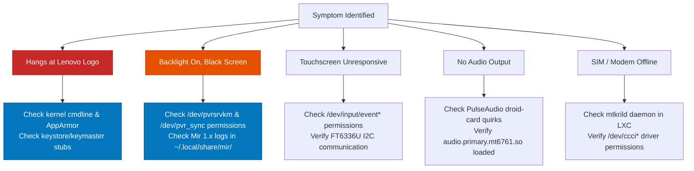

# Troubleshooting & Diagnostic Runbook — Lenovo TB-8505X

This document provides structured diagnostic procedures, root-cause analyses, and resolution steps for issues encountered during the Ubuntu Touch port on the Lenovo Tab M8 HD (`akita_row_call`).

---

## 1. Quick Diagnostic Decision Tree



---

## 2. Common Failure Modes & Verified Fixes

### 2.1 Boot Hangs at Lenovo Logo
* **Possible Causes:**
  1. `wait_for_keymaster` or `keystore` daemon hanging inside the Android LXC container.
  2. AppArmor panic due to missing namespace / inode traversal locking.
  3. Dynamic partition confusion (`systempart=/dev/mapper/system` mistakenly passed).
* **Diagnostic Commands (via ADB Shell):**
  ```bash
  adb shell dmesg | grep -iE "panic|apparmor|binder"
  adb shell cat /var/log/android.log
  ```
* **Mitigation:**
  - Verify that `overlay/system/etc/init/keystore.rc` and `wait_for_keymaster.rc` are deployed.
  - Verify `deviceinfo_kernel_cmdline` does not contain `systempart=/dev/mapper`.

### 2.2 Black Screen with Backlight On
* **Possible Causes:**
  1. Mir fails to connect to PowerVR EGL drivers.
  2. Node permissions on `/dev/pvrsrvkm` or `/dev/pvr_sync` are restricted.
  3. Missing sync fence support (`CONFIG_SW_SYNC=y`).
* **Diagnostic Commands:**
  ```bash
  adb shell cat ~/.local/share/mir/mir_demo_server.log
  adb shell ls -la /dev/pvrsrvkm /dev/pvr_sync /dev/ion /dev/sw_sync
  ```
* **Mitigation:**
  - Ensure `70-akita.rules` sets `MODE="0666"` on `/dev/pvrsrvkm` and `/dev/pvr_sync`.
  - Rebuild kernel with `CONFIG_SW_SYNC=y` and `CONFIG_SYNC_FILE=y`.

### 2.3 Audio Distortion or Immediate Playback Crash
* **Possible Causes:**
  1. PulseAudio attempting to control hardware volume registers directly.
  2. Sample rate mismatch between Ubuntu userspace and MT6357 codec (44.1 kHz vs 48 kHz).
* **Diagnostic Commands:**
  ```bash
  adb shell journalctl -u pulseaudio -e
  ```
* **Mitigation:**
  - Verify `overlay/system/etc/pulse/arm_droid_card_custom.pa` has `quirks=+no_hw_volume rate=48000`.

---

## 3. Critical Log Collection Procedure

When filing an issue or analyzing a failure, collect these four diagnostic files:

```bash
# 1. Complete Kernel Ring Buffer
adb shell dmesg > dmesg.log

# 2. Android Container Initialization Log
adb shell cat /var/log/android.log > android_lxc.log

# 3. Systemd Journal from Current Boot
adb shell journalctl -b 0 --no-pager > journal.log

# 4. Mir Display Compositor Log
adb shell cat ~/.local/share/mir/*.log > mir.log
```
