# Ubuntu Touch Architecture on MediaTek Hardware

## 1. Architectural Overview

Ubuntu Touch does not run Android applications or the Android Java runtime (ART). Instead, it runs a full **GNU/Linux system (Ubuntu 20.04 LTS arm64)** while leveraging the device's existing vendor drivers through a lightweight container and compatibility bridge called **libhybris**.

```mermaid
flowchart TD
    subgraph Host_Linux ["GNU/Linux Userspace (Ubuntu 20.04 Focal)"]
        Lomiri["Lomiri Shell (Qt5 / QML)"]
        Mir["Mir 1.x Display Server / Wayland Compositor"]
        Pulse["PulseAudio / PipeWire (Audio Server)"]
        BlueZ["BlueZ (Bluetooth Stack)"]
        NetworkMgr["NetworkManager / WPA Supplicant (Wi-Fi)"]
        Ofono["Ofono (Telephony & Cellular Data)"]
        Repowerd["Repowerd (Power & Backlight Management)"]
        Systemd["systemd (Init & Service Manager)"]
        
        Lomiri --> Mir
        Mir --> Libhybris
        Pulse --> Libhybris
        BlueZ --> Bluebinder["Bluebinder (HIDL Bridge)"]
        Ofono --> Libhybris
    end

    subgraph Libhybris_Bridge ["libhybris Compatibility Bridge (glibc <-> Bionic)"]
        Libhybris["libhybris<br/>(EGL, GLESv2, HWC2, Audio HAL, Camera HAL)"]
    end

    subgraph Android_Container ["Android LXC Container (Minimal Android 10 HALs)"]
        ServiceMgr["servicemanager / hwservicemanager / vndservicemanager"]
        HWC["hwcomposer.mt6761.so (SurfaceFlinger HWC2)"]
        Gralloc["gralloc.mt6761.so (Ashmem / Ion Buffer Allocator)"]
        AudioHAL["audio.primary.mt6761.so (MT6357 Audio HAL)"]
        RILD["rild (MediaTek Cellular Daemon)"]
        VendorBlobs["Stock Vendor Partition (/dev/block/mmcblk0p36)"]
        
        HWC --> VendorBlobs
        Gralloc --> VendorBlobs
        AudioHAL --> VendorBlobs
        RILD --> VendorBlobs
    end

    subgraph Linux_Kernel ["Downstream Linux Kernel (4.9.117 / 4.9.190+)"]
        BinderDev["/dev/binder, /dev/hwbinder, /dev/vndbinder"]
        AshmemDev["/dev/ashmem, /dev/ion"]
        PVRDev["PowerVR Rogue DDK (/dev/pvrsrvkm)"]
        MTKDisp["MediaTek Display Manager (/dev/mtk_disp_mgr)"]
        TouchDev["Linux evdev Input (/dev/input/event*)"]
        WiFiDev["MT6631 cfg80211 Driver (wlan0)"]
        AppArmor["AppArmor LSM Confinement"]
    end

    Libhybris --> HWC
    Libhybris --> Gralloc
    Libhybris --> AudioHAL
    Bluebinder --> ServiceMgr
    
    Android_Container --> BinderDev
    Android_Container --> AshmemDev
    Android_Container --> PVRDev
    Host_Linux --> TouchDev
    Host_Linux --> WiFiDev
    Host_Linux --> AppArmor
```

---

## 2. Core Functional Subsystems

### A. Display & Compositor (Mir & Lomiri)
1. **Lomiri Shell:** Built with Qt5 and QML, implementing phone/tablet multitasking, status indicators, and application launcher.
2. **Mir Display Server:** Acts as the Wayland compositor. It links to `libhybris` which dynamically wraps Android's `hwcomposer.mt6761.so` and `gralloc.mt6761.so`.
3. **Hardware Acceleration:** OpenGL ES 3.2 calls from Lomiri are routed directly to the PowerVR GE8300 GPU driver via `libGLES_PVR.so`.

### B. IPC & HAL Communication (Binder & gbinder)
- Modern Android 10 HALs use HIDL (Hardware Interface Definition Language) over `/dev/hwbinder` and `/dev/vndbinder`.
- Ubuntu Touch uses **libgbinder** to talk to Android daemons without needing full AOSP runtime services.
- The `gbinder.conf` configuration tells libgbinder which IPC protocol versions are supported by Android 10 (API level 29).

### C. Audio Subsystem (PulseAudio & module-droid-card)
- Linux uses PulseAudio as its native sound server.
- The `module-droid-card` plugin dynamically loads `audio.primary.mt6761.so` inside libhybris.
- Audio streams from Ubuntu applications are piped to the MediaTek audio hardware codec (MT6357 PMIC).

### D. Cellular & Telephony (Ofono)
- Ubuntu Touch uses Ofono as its mobile telephony daemon.
- MediaTek utilizes a proprietary modem protocol (`c6m_1rild`).
- The `ril_subscription.d/mtk.conf` plugin provides the necessary mapping between Ofono's D-Bus interface and MediaTek's `rild` socket.

---

## 3. Why Ubuntu Touch Differs from an Android GSI

| Dimension | Android GSI (e.g. LineageOS 18.1) | Ubuntu Touch (UBports) |
|---|---|---|
| **OS Architecture** | Android (Google AOSP runtime) | GNU/Linux (Debian/Ubuntu Focal 20.04 base) |
| **Userspace Runtime** | Java Virtual Machine (ART) + Bionic libc | Standard GNU C library (`glibc`), systemd, Python, shell |
| **Display Server** | Android `SurfaceFlinger` | Wayland Compositor (Mir) |
| **Application Ecosystem**| Android APKs (Dalvik bytecode) | Native Click packages, Debian `.deb`, Waydroid containers |
| **Init System** | Android `init` (`*.rc` scripts) | Standard Linux `systemd` (with Android init in LXC) |
| **Resource Usage** | Heavier memory footprint (~1.1 GB base) | Lightweight footprint (~400-500 MB base at idle) |
