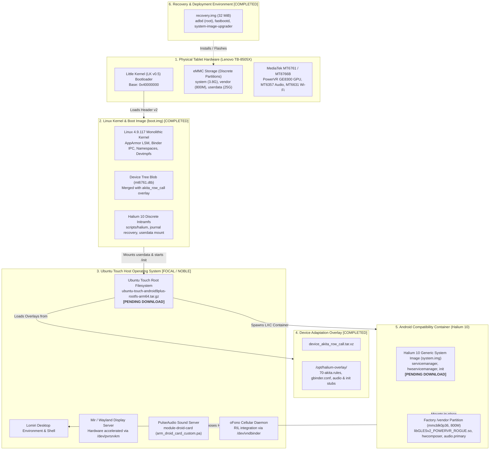

# Complete Ubuntu Touch Image Assembly & Architecture Specification

## 1. System Component Dependency Architecture

Ubuntu Touch on Android 10 (Halium 10) operates via a hybrid architecture where the host Ubuntu GNU/Linux operating system runs natively while Android hardware services run inside an unprivileged LXC container.



---

## 2. Component Deliverables Matrix

To clarify expectations: **The current `device_akita_row_call.tar.xz` archive is NOT a complete standalone Ubuntu Touch ROM by itself.**

Under official UBports architecture, an Ubuntu Touch installation consists of device-specific components combined with generic upstream distribution components:

| Component | Upstream / Device Specific | Source / Origin | Status in Project |
|---|---|---|---|
| **1. Standalone `boot.img`** | Device-Specific | Built from `kernel-lenovo-akita` + discrete Halium ramdisk | **COMPLETED** ([`out/boot.img`](file:///home/mreza/Desktop/TB8505X/TB8505X-ubuntutouch/out/boot.img)) |
| **2. Standalone `recovery.img`** | Device-Specific | Built from `kernel-lenovo-akita` + UBports unified recovery | **COMPLETED** ([`out/recovery.img`](file:///home/mreza/Desktop/TB8505X/TB8505X-ubuntutouch/out/recovery.img)) |
| **3. Adaptation Overlay** | Device-Specific | Packaged from [`overlay/`](file:///home/mreza/Desktop/TB8505X/TB8505X-ubuntutouch/overlay/) | **COMPLETED** ([`out/device_akita_row_call.tar.xz`](file:///home/mreza/Desktop/TB8505X/TB8505X-ubuntutouch/out/device_akita_row_call.tar.xz)) |
| **4. Factory Vendor Blobs** | Device-Specific | Stock `/vendor` partition (`mmcblk0p36`, 800 MiB) | **PRESERVED ON PHYSICAL DEVICE** |
| **5. Halium 10 GSI (`system.img`)** | Generic | UBports Halium 10 ARM64 Android compatibility image | **PENDING ACQUISITION** (Phase 5) |
| **6. Ubuntu Touch Rootfs** | Generic | UBports `ubuntu-touch-android9plus-rootfs-arm64.tar.gz` | **PENDING ACQUISITION** (Phase 5) |

---

## 3. Storage and Deployment Architecture

The Lenovo TB-8505X features discrete partitions without Android dynamic partitions (`super`):
- `system` (`mmcblk0p37`): 3.80 GiB (3,984,588,800 bytes)
- `vendor` (`mmcblk0p36`): 800 MiB (838,860,800 bytes)
- `userdata` (`mmcblk0p38`): 25.19 GiB (27,069,822,976 bytes)

### Deployment Layout
```text
/dev/block/by-name/
├── boot       (32M)  <-- Flashed with our custom boot.img
├── recovery   (32M)  <-- Flashed with our custom recovery.img
├── vendor     (800M) <-- Untouched stock factory vendor partition
├── system     (3.8G) <-- Formatted ext4, holds Halium 10 GSI system.img OR rootfs
└── userdata   (25G)  <-- Holds /rootfs.img (Ubuntu Touch rootfs) + user data
```

---

## 4. Missing Deliverables Before First Boot

Before the device can execute Lomiri on physical silicon, the following external components must be integrated:

1. **Halium 10 Generic System Image (`system.img`):**
   - Size: ~1.2 GiB.
   - Purpose: Provides Android 10 Bionic libc, `hwservicemanager`, and Binder IPC daemons required by MediaTek's closed-source PowerVR and RIL HALs.
2. **UBports Rootfs Archive (`ubuntu-touch-android9plus-rootfs-arm64.tar.gz`):**
   - Size: ~650 MiB compressed (~2.5 GiB uncompressed).
   - Purpose: The root Debian-based Ubuntu 20.04/24.04 filesystem containing systemd, Lomiri, and native applications.
3. **Pre-Unlock Calibration Backup:**
   - Mandatory prerequisite before bootloader unlock to safeguard cellular radio calibration.
4. **Bootloader Unlock:**
   - Little Kernel must be transitioned from `unlocked: no` to `unlocked: yes`.
5. **AVB Verification Bypass on `vbmeta`:**
   - Byte 123 patched to `0x03` to prevent Little Kernel from halting on unsigned boot images.
